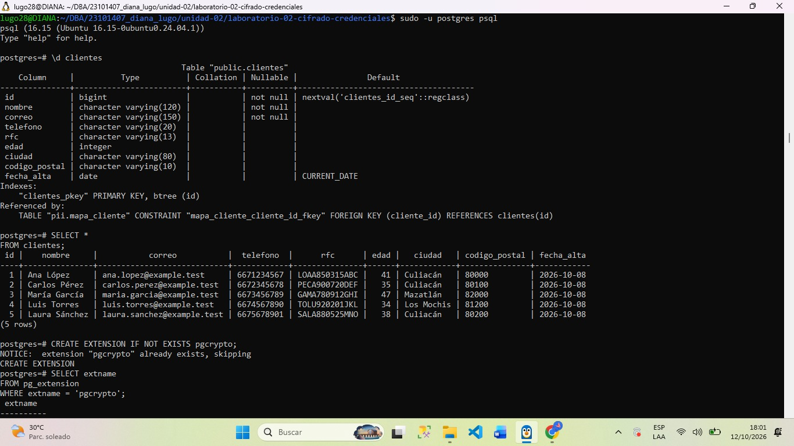
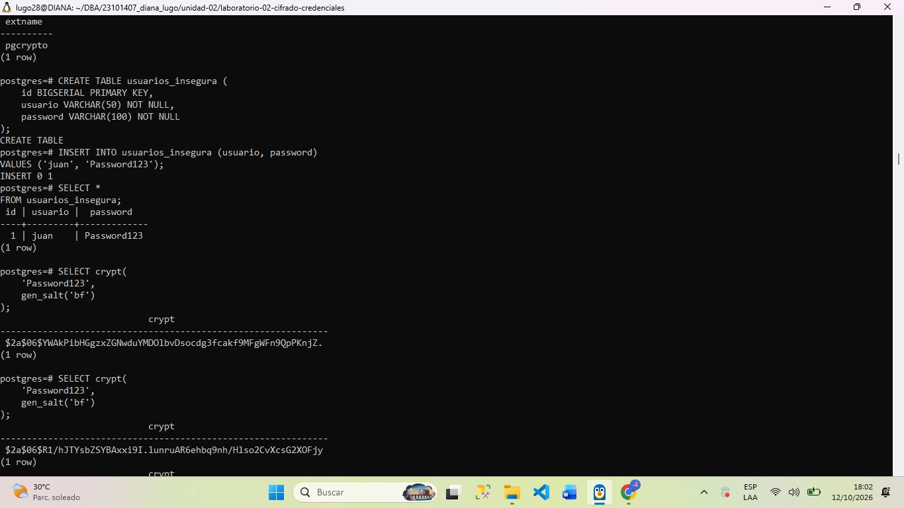
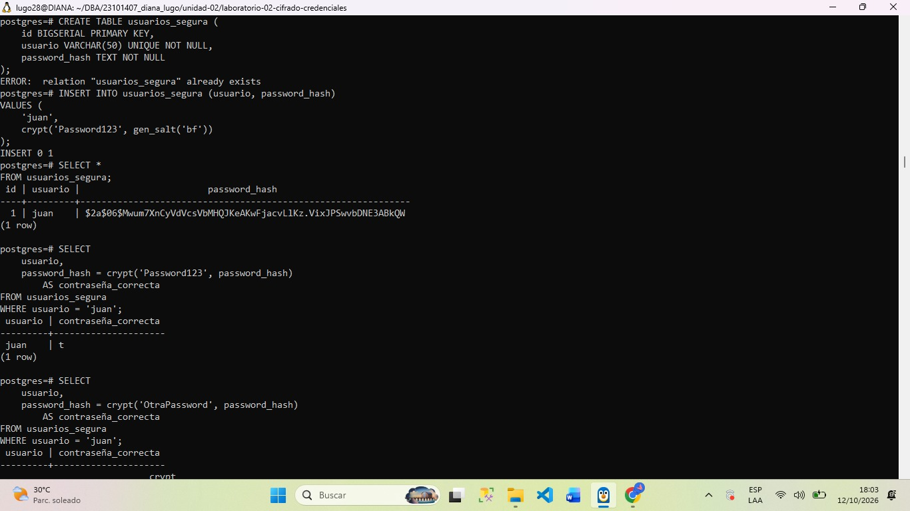

#DIANA YASMIN LUGO URIAS

##Evidencia 01 — Protección de credenciales

##  Objetivo
El objetivo de esta actividad es que identifiquemos los riesgos que existen al almacenar contraseñas en texto plano en una base de datos, y que así podamos entender la importancia de proteger las credenciales de los usuarios. También se busca que comprendamos las diferencias entre almacenar una contraseña directamente, generar un hash y verificar contraseña sin necesidad de ver el dato original.

## Comandos que se utilizaron
Verificar existencia de tabla
\d clientes

Validar la extension pgcryoto
CREATE EXTENSION IF NOT 
EXISTS pgcrypto;

Crear la tabla para demostrar el almacenamientos incorrecto de contraseñas 
CREATE TABLE usuarios_insegura (
    id BIGSERIAL PRIMARY KEY,
    usuario VARCHAR(50) NOT NULL,
    password VARCHAR(100) NOT NULL
);

Insertar el usuario de prueba con contraseña ficticia
INSERT INTO usuarios_insegura (usuario, password)
VALUES ('juan', 'Password123');

Consultar registros 
SELECT * FROM usuarios_insegura; 

Generar representacion no reversible  (se ejecuto dos veces)
SELECT crypt(
    'Password123',
    gen_salt('bf')
);

Crear tabla con las credenciales seguras
CREATE TABLE usuarios_segura (
    id BIGSERIAL PRIMARY KEY,
    usuario VARCHAR(50) UNIQUE NOT NULL,
    password_hash TEXT NOT NULL
);

Insertar usuario a la tabla segura
INSERT INTO usuarios_segura (usuario, password_hash)
VALUES (
    'juan',
    crypt('Password123', gen_salt('bf'))
);

Verificar contraseña correcta e incorrecta 
SELECT
    usuario,
    password_hash = crypt('Password123', password_hash)
        AS contraseña_correcta
FROM usuarios_segura
WHERE usuario = 'juan';

SELECT
    usuario,
    password_hash = crypt('OtraPassword', password_hash)
        AS contraseña_correcta
FROM usuarios_segura
WHERE usuario = 'juan';

## Resultados obtenidos
Cuando validamos contraseñas con Password123 se obtuvo true y con OtroPassword se obtuvo false, lo cual es correcto. El resultado de la primera contraseña indica que coincide con el hash que se almaceno en cambio el resultado de la segunda indica que no coincide.

## Analisis
Lo que yo puedo obtener como análisis es que almacenar contraseñas en texto plano es una muy mala práctica de seguridad, porque es mas facil que en una filtración de las bases de datos  las credenciales de los usuarios queden totalmente expuestas.
Tambien entendi que los hashes de una misma contraseña pueden ser totalmente diferentes ya que utilizan sales distintas y que este mecanismo no constituye a un cifrado reversible, ya que el objetivo del hash para las contraseñas es permitir su comprobación y no recuperar el texto original.
De igual forma sabemos que el uso de hashes no elimina por completo el riesgo por eso es que se deben de elegir algoritmos especializados para asi poder obtener las contraseñas y parametros adecuados

## Preguntas y respuestas

¿Qué ocurriría si una persona obtiene acceso de lectura a esta tabla?
Si una persona que no está autorizada obtiene acceso a la tabla podría conocer y consultar las contraseñas ya que se encuentran almacenadas solo en texto plano, esto provoca más problemas de seguridad ya que la persona no autorizada podría intentar reutilizar esa contraseña para acceder a otros sistemas . Además también podría haber una filtración de la base de datos ya que las credenciales se encuentran almacenadas en su formato original.

¿Son iguales los resultados de las dos consultas? 
No, normalmente los resultados deben de ser diferentes aunque sea la misma contraseña. 

Si no son iguales, ¿por qué?
porque al usar gen_salt(‘bf’) se genera una sal aleatoria en cada ejecución que se realiza y esto hace que dé como resultados hashes diferentes evitando que una misma contraseña produzca la misma representación almacenada

¿Qué función cumple gen_salt()?
Genera una sal aleatoria la cual se utiliza durante el cálculo de un hash.

 ¿Qué función cumple crypt()?
Nos ayuda a calcular un hash de la contraseña utilizando el algoritmo y parámetros indicados. También nos ayuda a verificar una contraseña ingresada con un hash, sin necesidad de recuperar la contraseña original.

¿Esto es cifrado reversible?
No, ya que el hash es solo un proceso de contraseñas, no un cifrado reversible, es decir, el hash esta diseñado para verificar la contraseña pero no para que se recupere el texto original mediante alguna clave de descifrado.

¿Qué resultado obtuviste con la contraseña correcta?*
True, porque esa contraseña coincide con la que se utilizó para generar el hash almacenado en la tabla.

¿Qué resultado obtuviste con la contraseña incorrecta?
False, ya que esa contraseña no coincide con la que se utilizo para generar el hash.

¿Por qué no es necesario recuperar la contraseña original?
Porque el sistema puede calcular un nuevo hash utilizando la contraseña que se ingreso y compararlo con el hash que se obtuvo originalmente.

 ¿Por qué un hash no debe confundirse con cifrado?
Porque un hash es una representación calculada mediante una función diseñada para ese propósito que no piensa en recuperar el texto original. En cambio, el cifrado utiliza un algoritmo y una clave para transformar los datos, de modo que puedan recuperarse mediante el descifrado autorizado. Por eso, para proteger contraseñas se utilizan algoritmos especializados de hash, no cifrado reversible.

## Conclusión
Me permitió identificar los riesgos de almacenar contraseñas en texto plano y comprender cómo protegerlas mediante hashes. Con las funciones gen_salt() y crypt() se generaron representaciones de las contraseñas y se comprobó cómo verificar credenciales correctas e incorrectas sin recuperar el valor original.

##Evidencias de imagenes

### Evidencia 1. Extensión pgcrypto

### Evidencia 2. Usuarios con contraseña insegura

### Evidencia 3. Hash de contraseña

