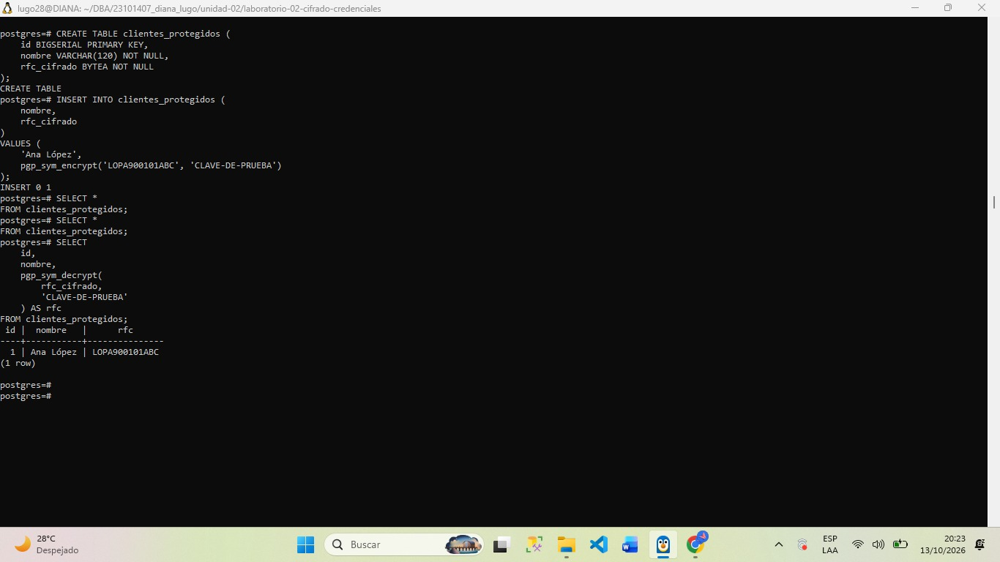

## DIANA YASMIN LUGO URIAS

##Evidencia actividad 2 - cifrado de información sensible

##Objetivo
El objetivo de esta actividad es aprender a aplicar el cifrado simétrico a un dato sensible, utilizamos el campo de RFC para realizar el ejemplo , y las funciones de pgp_sym_encrypt() y pgo_syn_decrypt().

##Comandos que se utilizaron
Creación de la tabla
CREATE TABLE clientes_protegidos (
    id BIGSERIAL PRIMARY KEY,
    nombre VARCHAR(120) NOT NULL,
    rfc_cifrado BYTEA NOT NULL
);

Insertar el dato cifrado
INSERT INTO clientes_protegidos (
    nombre,
    rfc_cifrado
)
VALUES (
    'Ana López',
    pgp_sym_encrypt('LOPA900101ABC', 'CLAVE-DE-PRUEBA')
);

Consultar la información cifrada
SELECT *
FROM clientes_protegidos;

Recuperar el dato original
SELECT
    id,
    nombre,
    pgp_sym_decrypt(
        rfc_cifrado,
        'CLAVE-DE-PRUEBA'
    ) AS rfc
FROM clientes_protegidos;

##Preguntas y respuestas
¿Qué diferencia existe entre crypt() y pgp_sym_encrypt()?
La funcion crypt() se utiliza para generar hashes de contraseñas y comprobarlas, el hash como sabemos es un resultado que permite verificar una contraseña sin recuperar el dato original.
En cambio pgp_sym_encrypt() nos ayuda a cifrar información mediante una clave simetrica. El dato se puede recuperar utilizando pgp_sym_decrypt() y la clave correcta.
¿Cuál de los dos mecanismos permite recuperar el dato original?
pgp_sym_encrypt() nos permite recuperar el dato original mediante pgp_sym_decrypt(), siempre que se disponga de la clave correcta y los datos cifrados no estén dañados.
Por otro lado ,crypt() no está diseñado para recuperar la contraseña original a partir del hash.

¿Qué ocurre si se utiliza una clave incorrecta?
La función pgp_sym_decrypt() generaria un error de descifrado cuando se utiliza una clave incorrecta y no se recupera correctamente el dato original.

¿Qué problema de seguridad representa colocar la clave directamente en una consulta?
La clave podría quedar expuesta en el historial de comandos, registros o herramientas de monitoreo. Además si una persona con acceso no autorizado obtiene la clave y datos cifrados, podría descifrarlos.

##Conclusión
Esta actividad me permitió comprobar que el cifrado simétrico protege la confidencialidad de los datos sensibles almacenados en PosrgeSQL. También entender que el hash y el cifrado cumplen funciones diferentes pero ambas son importantes para conservar la seguridad de los datos

##Evidencia imagen

### Evidencia del cifrado de datos

