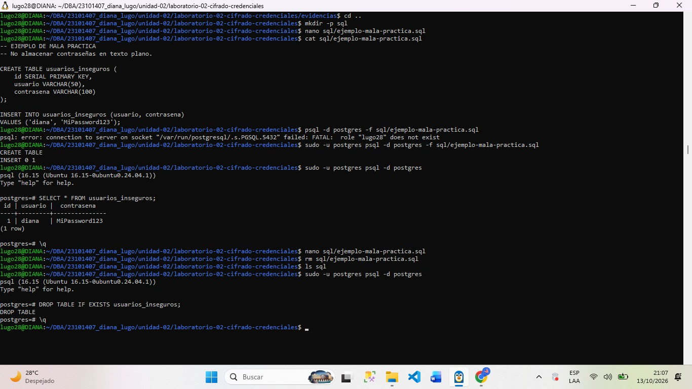

## DIANA YASMIN LUGO URIAS

##Evidencia actividad 3 - problema de la gestión de claves

##objetivo
El objetivo de esta práctica es que aprendamos a identificar los riesgos de incluir claves de cifrado directamente en consultas SQL y entender la importancia de proteger los secretos utilizados para acceder a información sensible

##Comandos que se utilizaron
Crear el archivo
mkdir -p sql
nano sql/ejemplo-mala-practica.sql

Ejecutar el archivo en postgres
sudo -u postgres psql -d postgres -f sql/ejemplo-mala-practica.sql

Eliminar el archivo una vez que se realizo la practica
rm sql/ejemplo-mala-practica.sql

##Resultados obtenidos
Durante esta actividad se analizó el riesgo de incluir una clave de cifrado directamente en una consulta SQL. Se utilizó el valor ficticio CLAVE-DE-PRUEBA para demostrar cómo la función pgp_sym_decrypt() puede recuperar información previamente cifrada cuando se proporciona la clave correcta.
Finalmente, se estableció que el archivo temporal debe eliminarse antes de la entrega y que no deben almacenarse claves, contraseñas, tokens ni otros secretos reales en el repositorio.

##Conclusion
La actividad me permitió comprender que una clave expuesta puede comprometer la confidencialidad de los datos protegidos. Por ello, es necesario utilizar claves ficticias en las demostraciones académicas, evitar publicar secretos en Git y emplear mecanismos seguros de gestión de claves en entornos reales.

##Evidencia de imagen

### Evidencia de gestión de claves

