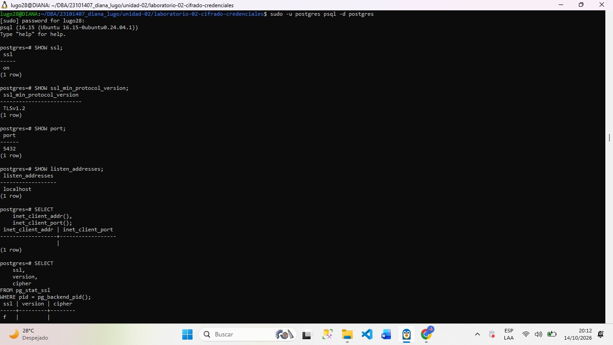
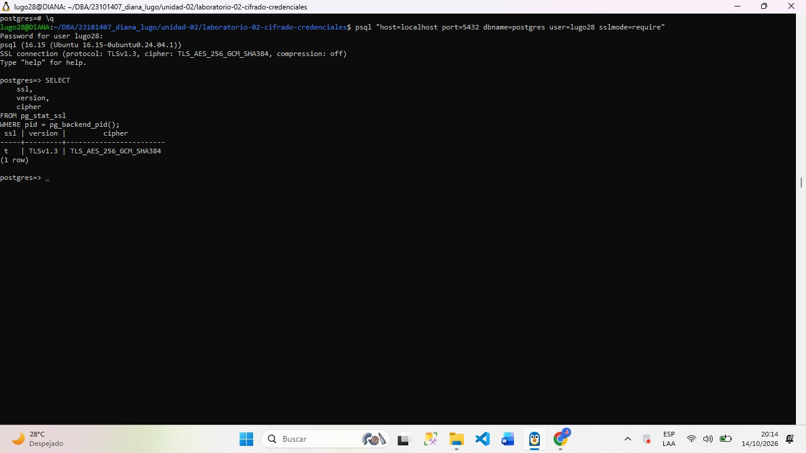

##DIANA YASMIN LUGO URIAS

##Evidencias actividad 04 - Verificar el estado de tsl en el estado de PostgreSQL

##Objetivo
El objetivo de esta actividad es que podamos verificar la configuración de seguridad TLS de PostgreSQL, saber cual es  la versión mínima del protocolo permitida, comprobar el puerto de conexión y determinar si una sesión utiliza cifrado. Además tambien fue establecer una conexión mediante psql utilizando sslmode=require y analizar los resultados obtenidos.

##Comandos que se utilizaron
Ingresar a PostgreSQL
sudo -u postgres psql -d postgres

Comandos para confirmar la configuración SSL/TLS
SHOW ssl;
SHOW ssl_min_protocol_version;
SHOW port;
SHOW listen_addresses;

Validar la conexión local
SELECT
    inet_client_addr(),
    inet_client_port();

Consultar el estado TSL de la sesión actual
SELECT
    ssl,
    version,
    cipher
FROM pg_stat_ssl
WHERE pid = pg_backend_pid();

Establecer conexion con mi usuario
psql "host=localhost port=5432 dbname=postgres user=lugo28 sslmode=require"

Ejecutar de nuevo la consulta
SELECT
    ssl,
    version,
    cipher
FROM pg_stat_ssl
WHERE pid = pg_backend_pid();

##Resultado obtenido
La primer consulta de dirección y puerto del cliente devolvió valores vacíos (NULL), por lo tanto esta sesión local no utiliza TLS
En la segunda conexión mediante psql se realizó correctamente con mi usuario y el parámetro sslmode=require.

Se mostró el siguiente mensaje:

SSL connection (protocol: TLSv1.3,
cipher: TLS_AES_256_GCM_SHA384,
compression: off)

Esto significa que la sesion actual esta utilizando TLS

##	Análisis

¿La conexión actual utiliza TLS?
La primer conexion local, realizada mediante sudo -u postgres psql -d postgres, no utilizaba TLS, como indica el valor ssl = f. En cambio, la conexión TCP realizada con sslmode=require sí utiliza TLS, como confirma el valor ssl = t.

¿Qué versión de TLS se está utilizando?
En la conexión TCP protegida se utiliza TLS 1.3. El servidor también informa que su versión mínima configurada es TLS 1.2.

¿Qué algoritmo de cifrado aparece?
El cifrado es TLS_AES_256_GCM_SHA384. Utiliza AES con una clave de 256 bits en modo GCM, que proporciona confidencialidad e integridad, y SHA-384 como función hash.

¿Qué diferencia existe entre una conexión protegida con TLS y una conexión sin TLS?
Una conexión protegida con TLS cifra los datos transmitidos entre el cliente y el servidor, dificultando que terceros puedan leer o modificar la información durante el tránsito. Una conexión sin TLS no proporciona esa protección criptográfica para la comunicación, por lo que los datos pueden quedar expuestos a la observación o manipulación si alguien logra interceptar el tráfico.

¿Qué función cumple sslmode=require?
Este parámetro exige que la conexión utilice TLS. Sin embargo, no garantiza por sí solo la verificación completa de la identidad del servidor. Para una validación más estricta, verify-full comprueba la cadena de confianza del certificado y que el nombre del servidor coincida con el certificado, siempre que se configure correctamente el certificado de confianza.

¿Por qué la primera conexión no utilizó TLS si SHOW ssl devolvió on?
Porque SHOW ssl indica que el servidor tiene habilitada la capacidad de aceptar conexiones TLS; no significa que todas las sesiones estén cifradas. La primera sesión utilizó un socket local de Unix, mientras que la segunda se estableció mediante TCP con TLS 
obligatorio.

##Conclusión

La práctica me permitió comprobar que PostgreSQL tiene habilitado SSL/TLS, escucha en el puerto 5432 y establece TLS 1.2 como versión mínima permitida. También se comprobó que una conexión local mediante socket puede no utilizar TLS, aunque el servidor tenga esta función habilitada.

Finalmente, la conexión TCP realizada con sslmode=require se estableció correctamente y utilizó TLS 1.3 con el cifrado TLS_AES_256_GCM_SHA384. Entiendo que es importante verificar el estado de cada sesión y no limitarse a consultar la configuración general del servidor. 

##Evidencia en imagen

### Evidencia 1. Configuración SSL/TLS

### Evidencia 2. Verificación de conexión cifrada

