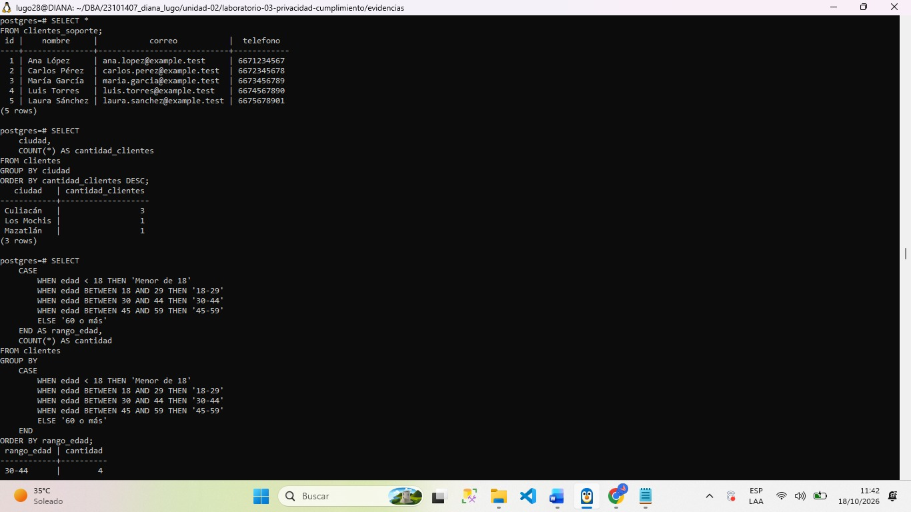
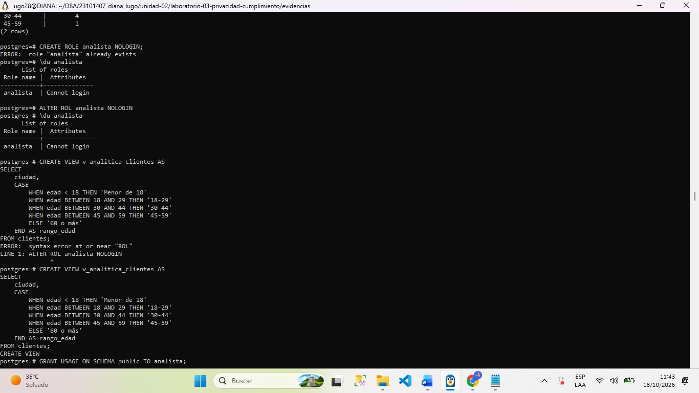
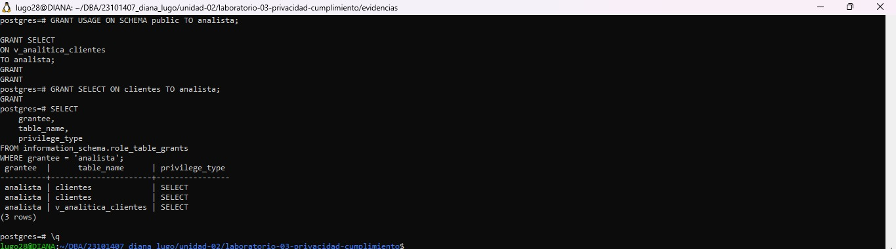

DIANA YASMIN LUGO URIAS
## Evidencias actividad 5 - Finalidad secundaria

1. ¿El hecho de que la organización ya tenga los datos significa automáticamente que puede utilizarlos para cualquier finalidad? No, esto no significa que pueda utilizarlos para cualquier actividad. Esta información debe de tratarse con la finalidad para la que se recopiló y bajo condiciones legales necesarias.
Antes de enviar promociones se debe verificar si la información fue recopilada con esta finalidad y si tiene la base legal adecuada.

2. ¿Qué preguntas debería realizar la organización antes de implementar este tratamiento?  Considero que las organizaciones de deberían de plantear preguntas como:
¿Con qué finalidad se recopilaron originalmente los datos de los clientes?
¿Se informó a los clientes que sus datos podrían utilizarse para fines publicitarios o promocionales?
¿Qué datos personales son indispensables para personalizar las promociones?
¿Durante cuánto tiempo se conservarán los datos utilizados para esta finalidad?
¿Cómo podrán los clientes oponerse a recibir promociones o ejercer sus derechos sobre sus datos personales?
¿Qué personas o departamentos tendrán acceso a la información?
¿Cómo se protegerán los datos contra accesos no autorizados, pérdidas o divulgaciones?
¿Se utilizarán herramientas externas para analizar el comportamiento de compra

3. ¿Qué datos serían realmente necesarios?
La organización debe utilizar únicamente los datos necesarios para cumplir con la finalidad promocional.
Ejemplo, se podría necesitar una categoría de edad, una zona geográfica general y las categorías de productos comprados, siempre y cuando se justifique el porqué de su necesidad.
No necesariamente necesita el nombre completo, RFC, teléfono, correo electrónico, dirección exacta u otros datos que permitan identificar directamente al cliente durante el análisis.

4. ¿Necesitaría el área de marketing acceso directo a clientes? 
No necesariamente, ya que el área de marketing no debería de tener acceso a toda la tabla con información del cliente si se puede cumplir su función utilizando una vista solo con la información limitada. Conceder acceso completo podría exponer datos personales que no son indispensables para diseñar promociones. Por eso es que se recomienda aplicar el principio de mínimo privilegio y proporcionar únicamente los datos necesarios para cada actividad.
5. ¿Qué controles técnicos podrían limitar la información entregada?
La organización podría implementar los siguientes controles técnicos:
Vistas de acceso limitado: crear vistas SQL que expongan únicamente las columnas necesarias para las actividades de marketing.
Principio de mínimo privilegio: crear un rol específico para marketing y concederle solo los permisos indispensables.
Control de acceso por roles (RBAC): separar los permisos de marketing, soporte y administración de bases de datos.
Seudonimización: sustituir identificadores directos por códigos cuando sea posible realizar el análisis sin conocer la identidad del cliente.
Agregación de datos: trabajar con estadísticas por grupos de edad, regiones o categorías de productos, reduciendo la exposición de registros individuales
Registro de auditoría: registrar los accesos y las consultas relevantes para detectar usos indebidos.
Seguridad de las cuentas: utilizar cuentas individuales, autenticación adecuada y revisión periódica de los permisos asignados.

Conclusión

La utilización de datos personales para enviar promociones personalizadas debe evaluarse antes de implementarse. Tener los datos almacenados no autoriza automáticamente una finalidad nueva.
La empresa debe justificar el tratamiento, informar adecuadamente a los clientes, determinar qué datos son indispensables y establecer controles técnicos que limiten el acceso a la información. El uso de vistas, roles con permisos restringidos, seudonimización y auditoría permite reducir los riesgos y aplicar los principios de privacidad desde el diseño y mínimo privilegio.

## Evidencias de imágenes

### Evidencia 1. Análisis de la finalidad secundaria

### Evidencia 2. Evaluación de los datos necesarios

### Evidencia 3. Controles de acceso y privacidad

