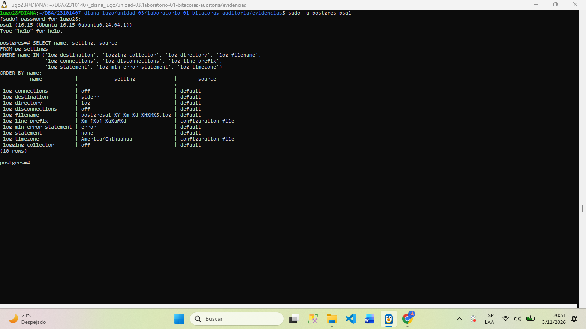

# Actividad 1 — Revisar la configuración de registro por defecto

**Estudiante:** Lugo Urías Diana Yasmin  
**Unidad:** 3  
**Laboratorio:** 01 — Bitácoras y auditoría  
**Actividad:** 1 — Revisar la configuración de registro por defecto

## 1. Objetivo

El propósito de esta actividad fue conocer cómo se encuentra configurado PostgreSQL para registrar las actividades que se realizan en el servidor. Para ello, revisé algunos parámetros relacionados con las conexiones, las sentencias SQL, los errores y la fecha en que se generan los eventos.

## 2. Comando ejecutado

Desde la sesión de administrador de PostgreSQL ejecuté la siguiente consulta:

```sql
SELECT name, setting, source
FROM pg_settings
WHERE name IN ('log_destination', 'logging_collector', 'log_directory', 'log_filename',
               'log_connections', 'log_disconnections', 'log_line_prefix',
               'log_statement', 'log_min_error_statement', 'log_timezone')
ORDER BY name;
```

## 3. Resultado obtenido

La consulta mostró 10 parámetros con sus respectivos valores y el origen de su configuración.

| Parámetro | Valor | Origen |
|---|---|---|
| log_connections | off | default |
| log_destination | stderr | default |
| log_directory | log | default |
| log_disconnections | off | default |
| log_filename | postgresql-%Y-%m-%d_%H%M%S.log | default |
| logging_collector | off | default |
| log_line_prefix | %m [%p] | default |
| log_min_error_statement | error | default |
| log_statement | none | default |
| log_timezone | Etc/UTC | configuration file |

## 4. Análisis y respuestas

**1. ¿Con esta configuración se registra quién se conecta?**

No, porque el parámetro `log_connections` está en `off`. Esto significa que PostgreSQL no tiene habilitado el registro de las conexiones exitosas. Por lo tanto, si alguien ingresa al servidor, no se genera un registro de conexión mediante esta opción.

**2. ¿Se registran las sentencias UPDATE?**

No. Al revisar el parámetro `log_statement`, observé que tiene el valor `none`. Esto indica que PostgreSQL no está registrando las sentencias SQL que ejecutan los usuarios, incluyendo las instrucciones UPDATE.

**3. ¿La línea de bitácora incluye el usuario o la dirección IP del cliente?**

No. El parámetro `log_line_prefix` tiene configurado `%m [%p]`, que permite identificar la fecha y hora del evento y el número del proceso. Sin embargo, no muestra el nombre del usuario ni la dirección IP desde donde se realizó la conexión.

**4. ¿En qué zona horaria se registran los eventos? ¿Por qué importa al reconstruir una cronología?**

Los eventos se registran utilizando la zona horaria UTC, como lo indica el parámetro `log_timezone`. Esto es importante porque permite ordenar y comparar los acontecimientos con una misma referencia de tiempo, especialmente cuando se necesita investigar qué sucedió primero o comparar registros de diferentes servidores.

**5. Con logging_collector = off, ¿quién decide dónde termina la bitácora: PostgreSQL o el mecanismo con que se desplegó el servidor?**

En este caso, PostgreSQL envía los mensajes de registro a `stderr` (salida de error estándar), porque así lo indica `log_destination`. Como `logging_collector` está desactivado, PostgreSQL no se encarga de recopilar esos mensajes en archivos propios. El destino final depende del mecanismo utilizado para iniciar el servidor, como el sistema operativo, el servicio o un contenedor.

## 5. Conclusión

Con esta actividad pude conocer cómo se encuentra configurado PostgreSQL para guardar información sobre lo que sucede en el servidor. Al revisar los parámetros, me di cuenta de que varias opciones importantes están desactivadas, como el registro de conexiones y de sentencias SQL.

Esto me permitió comprender que tener una base de datos funcionando no significa necesariamente que todas las actividades estén siendo registradas. Para poder investigar algún problema o identificar acciones realizadas por los usuarios, es importante contar con una configuración de bitácoras adecuada que permita tener un mejor seguimiento de lo que sucede en el servidor.

## 6. Evidencia foto

