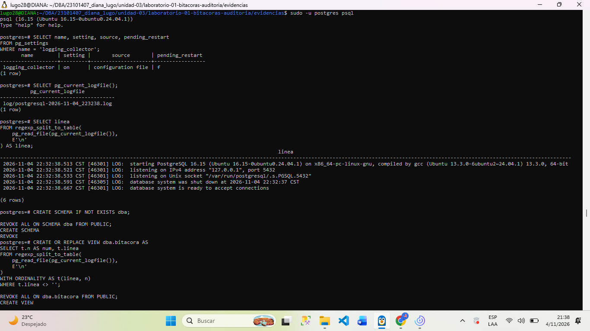
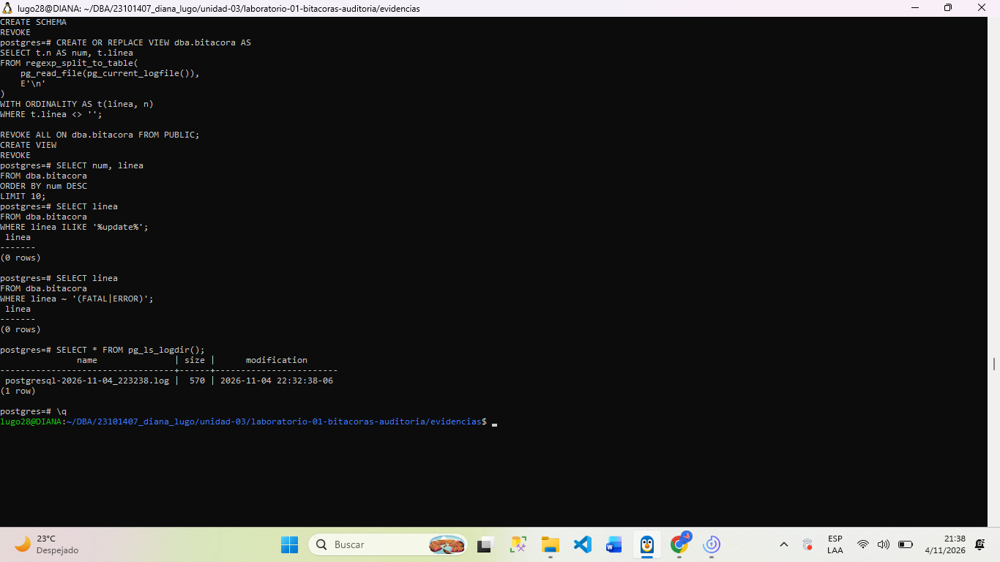

# Actividad 2 — Activar el colector y crear una vista de bitácora

**Estudiante:** Lugo Urías Diana Yasmin  
**Unidad:** 3  
**Laboratorio:** 01 — Bitácoras y auditoría  
**Actividad:** 2 — Activar el colector y crear una vista

## 1. Objetivo

El objetivo de esta actividad fue aprender a activar el colector de registros de PostgreSQL y conocer cómo se almacena la información de las actividades que ocurren en el servidor.

Durante la práctica también aprendí a consultar los archivos de bitácora directamente desde SQL y a crear una vista que facilita la búsqueda de información. Esto me permitió comprender mejor la importancia de conservar registros para poder revisar lo que sucede en una base de datos.

## 2. Comandos ejecutados

Primero revisé el estado del colector para conocer si estaba activado. Después utilicé el siguiente comando para habilitarlo:

```sql
ALTER SYSTEM SET logging_collector = on;
```

Para comprobar el cambio ejecuté:

```sql
SELECT name, setting, pending_restart
FROM pg_settings
WHERE name = 'logging_collector';
```

Al principio el parámetro todavía aparecía como `off`, porque PostgreSQL necesita reiniciarse para aplicar este tipo de modificación.

Después de reiniciar el servicio, volví a consultar su configuración:

```sql
SELECT name, setting, source, pending_restart
FROM pg_settings
WHERE name = 'logging_collector';
```

Para reiniciar PostgreSQL utilicé el siguiente comando desde Ubuntu:

```bash
sudo systemctl restart postgresql
```

## 3. Resultado obtenido

Después de reiniciar el servicio, el parámetro `logging_collector` apareció con el valor `on` y su origen como `configuration file`.

Esto confirmó que el colector quedó activado correctamente.

Posteriormente consulté la ubicación del archivo de bitácora mediante:

```sql
SELECT pg_current_logfile();
```

La consulta mostró la ruta del archivo que PostgreSQL estaba utilizando para guardar los registros actuales.

También pude leer su contenido con la siguiente instrucción:

```sql
SELECT linea
FROM regexp_split_to_table(
    pg_read_file(pg_current_logfile()),
    E'\n'
) AS linea;
```

Al revisar los resultados encontré información relacionada con el inicio del servidor, las direcciones de escucha y el momento en que PostgreSQL quedó listo para aceptar conexiones.

## 4. Creación de la vista de bitácora

Después de comprobar que podía leer el archivo, creé un esquema llamado `dba` para organizar los elementos relacionados con la administración de la base de datos.

Utilicé los siguientes comandos:

```sql
CREATE SCHEMA dba;

REVOKE ALL ON SCHEMA dba FROM PUBLIC;
```

Posteriormente creé la vista `dba.bitacora`:

```sql
CREATE OR REPLACE VIEW dba.bitacora AS
SELECT t.n AS num, t.linea
FROM regexp_split_to_table(
    pg_read_file(pg_current_logfile()),
    E'\n'
)
WITH ORDINALITY AS t(linea, n)
WHERE t.linea <> '';
```

También restringí los permisos generales de consulta:

```sql
REVOKE ALL ON dba.bitacora FROM PUBLIC;
```

Con esta vista pude consultar los registros utilizando instrucciones SQL, sin tener que abrir directamente el archivo desde Ubuntu.

## 5. Consultas realizadas

Para comprobar que la vista funcionaba correctamente realicé diferentes consultas.

**Consultar las últimas 10 líneas:**

```sql
SELECT num, linea
FROM dba.bitacora
ORDER BY num DESC
LIMIT 10;
```

**Buscar registros relacionados con UPDATE:**

```sql
SELECT linea
FROM dba.bitacora
WHERE linea ILIKE '%update%';
```

**Buscar mensajes de error:**

```sql
SELECT linea
FROM dba.bitacora
WHERE linea ~ '(FATAL|ERROR)';
```

**Consultar los archivos de bitácora disponibles:**

```sql
SELECT * FROM pg_ls_logdir();
```

Estas consultas me ayudaron a comprender que los registros pueden revisarse y filtrarse de diferentes maneras, dependiendo de la información que necesitemos encontrar.

## 6. Análisis y respuestas

**1. ¿Por qué logging_collector requiere reinicio y log_statement solo recarga?**

Porque `logging_collector` necesita iniciar un proceso que se encargue de recopilar los mensajes y guardarlos en archivos. Por esta razón, PostgreSQL necesita reiniciarse para activar correctamente este mecanismo.

En cambio, `log_statement` solamente controla qué instrucciones SQL se guardan en la bitácora. Este parámetro puede modificarse mediante una recarga de la configuración, sin tener que reiniciar todo el servidor.

**2. ¿Qué ventaja tiene que la bitácora se lea con SQL y no con una herramienta del sistema operativo o del contenedor? ¿Qué riesgo introduce?**

Una ventaja es que podemos consultar la información directamente desde PostgreSQL, utilizando comandos SQL que permiten buscar palabras, identificar errores y revisar los registros más recientes. Esto hace que el trabajo sea más sencillo y evita tener que salir constantemente de la base de datos para revisar los archivos.

Sin embargo, también existe un riesgo: si no se controlan correctamente los permisos, algunas personas podrían acceder a información que no les corresponde. Las bitácoras pueden contener datos importantes sobre los usuarios y las actividades realizadas en el servidor, por lo que es necesario protegerlas.

**3. ¿Quién debería poder consultar dba.bitacora?**

Considero que esta vista debería estar disponible únicamente para el administrador de la base de datos y para las personas autorizadas que tengan responsabilidades de supervisión o auditoría.

No sería conveniente permitir que cualquier usuario consulte estos registros, ya que contienen información que podría comprometer la seguridad y privacidad de la base de datos.

## 7. Conclusión

Al realizar esta actividad aprendí que las bitácoras son una parte importante de la administración de PostgreSQL, porque permiten conocer lo que sucede dentro del servidor y conservar información que puede ser útil cuando se presenta algún problema.

También comprendí que algunos cambios en la configuración necesitan reiniciar el servicio para poder aplicarse, como sucedió al activar `logging_collector`.

Una de las partes que me pareció más interesante fue crear la vista `dba.bitacora`, porque permite consultar los registros directamente mediante SQL y facilita encontrar información específica.

Finalmente, entendí que no solamente es importante guardar los registros, sino también protegerlos y controlar quién puede consultarlos. De esta manera, las bitácoras se convierten en una herramienta útil para mejorar la seguridad, el seguimiento y la administración de una base de datos.

## 8. Evidencia foto



