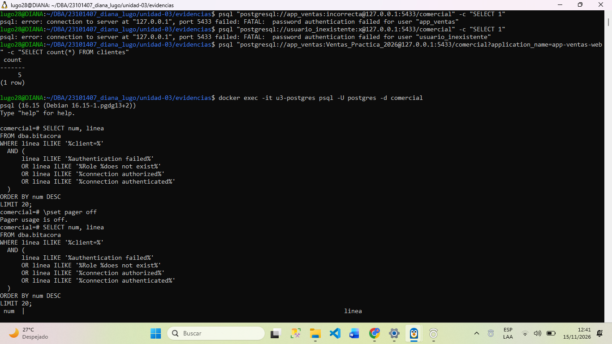
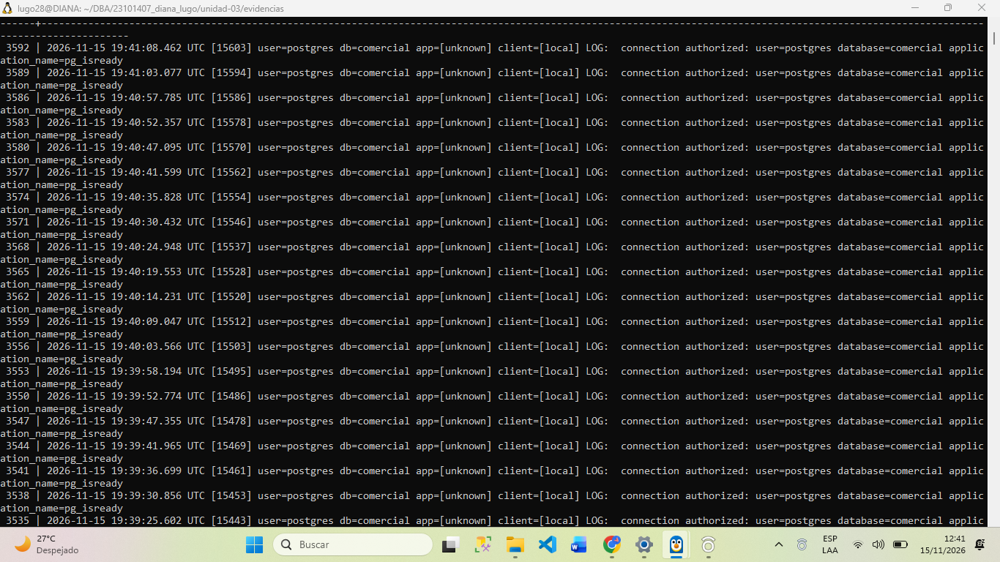

# Actividad 5. Accesos exitosos y fallidos

**Estudiante:** Lugo Urías Diana Yasmin

**Unidad:** 3

**Laboratorio:** 01 — Bitácoras y auditoría

## 1. Desarrollo de la actividad

En esta actividad realicé tres pruebas de conexión a la base de datos `comercial`. El propósito fue comprobar cómo responde PostgreSQL cuando alguien intenta ingresar con una contraseña incorrecta, cuando utiliza un usuario que no existe y cuando se conecta correctamente.

Primero hice un intento utilizando el usuario `app_ventas`, pero escribí una contraseña incorrecta. Después intenté ingresar con un usuario llamado `usuario_inexistente`, que no está registrado en la base de datos. Finalmente, realicé una conexión utilizando las credenciales correctas de `app_ventas`.

Los resultados fueron los siguientes:

- **Primer intento:** la conexión fue rechazada porque la contraseña de `app_ventas` era incorrecta.
- **Segundo intento:** PostgreSQL rechazó la conexión porque el usuario `usuario_inexistente` no existe.
- **Tercer intento:** la conexión fue exitosa y pude consultar la cantidad de registros de la tabla `clientes`.

La última consulta devolvió el resultado `5`, lo que significa que la tabla tenía cinco registros.

## 2. Revisión de la bitácora

Después de realizar las pruebas, ingresé como administrador y revisé los registros de PostgreSQL para encontrar información sobre los intentos de conexión.

En mi caso, las conexiones aparecieron con la dirección `172.21.0.1`, en lugar de `127.0.0.1`, porque estoy trabajando con PostgreSQL dentro de un contenedor Docker.

En la bitácora pude identificar lo siguiente:

| Intento | Usuario | Resultado |
|---|---|---|
| Primero | app_ventas | Contraseña incorrecta |
| Segundo | usuario_inexistente | El usuario no existe |
| Tercero | app_ventas | Conexión exitosa |

También encontré información sobre el método de autenticación utilizado, que fue `scram-sha-256`, y la regla de conexión correspondiente en el archivo `pg_hba.conf`.

Esto me permitió observar que PostgreSQL guarda información tanto de las conexiones que se realizan correctamente como de los intentos que son rechazados.

## 3. Análisis de los registros

Algo que me pareció interesante fue que, aunque la primera conexión no pudo realizarse, PostgreSQL sí registró el nombre del usuario que se intentó utilizar.

En el segundo intento también apareció un mensaje adicional indicando que el rol `usuario_inexistente` no existía.

En cambio, en la conexión correcta aparecieron mensajes de autenticación y autorización, además de la aplicación `app-ventas-web`.

Con esto pude distinguir mejor cómo se comporta el servidor dependiendo del resultado de cada intento de conexión.

## 4. Respuestas a las preguntas

**1. La bitácora registra el usuario app_ventas en el intento fallido. ¿Eso prueba que la aplicación de ventas intentó entrar? ¿Qué prueba realmente?**

No necesariamente. Que aparezca `app_ventas` solamente demuestra que alguien intentó conectarse utilizando ese nombre de usuario. No significa que haya sido la aplicación de ventas, ya que también pudo ser otra persona o programa utilizando esas credenciales.

**2. ¿Qué información adicional registra PostgreSQL cuando el rol no existe? ¿Por qué aparece en la bitácora y no en el mensaje que recibe el cliente?**

PostgreSQL registra información adicional indicando que el rol `usuario_inexistente` no existe. Esta información queda en la bitácora para que el administrador pueda revisar con más detalle lo que ocurrió. Al cliente se le muestra un mensaje más general de error de autenticación, evitando revelar demasiada información sobre los usuarios registrados en el servidor.

**3. ¿Por qué app=[unknown] en el intento fallido, pero app=app-ventas-web en la desconexión?**

Porque en el intento fallido no se llegó a completar la conexión y PostgreSQL todavía no tenía disponible el nombre de la aplicación. En el intento correcto sí se pudo completar la autenticación y reconocer el nombre `app-ventas-web`, por eso aparece en el registro de desconexión.

**4. ¿Qué patrón de varias líneas te haría sospechar de un ataque de fuerza bruta? Escribe la consulta que contaría los intentos fallidos por usuario.**

Me haría sospechar encontrar muchos intentos de conexión fallidos en poco tiempo, especialmente cuando se repiten desde una misma dirección o se prueban diferentes contraseñas y usuarios.

Para contar los intentos fallidos por usuario se puede utilizar la siguiente consulta:

```sql
SELECT
    substring(linea FROM 'user=([^ ]+)') AS usuario,
    COUNT(*) AS intentos_fallidos
FROM dba.bitacora
WHERE linea ILIKE '%password authentication failed%'
GROUP BY usuario
ORDER BY intentos_fallidos DESC;
```

Esta consulta permite identificar qué usuarios aparecen con mayor frecuencia en los intentos de autenticación fallidos.

## 5. Conclusión

Con esta actividad aprendí que las bitácoras de PostgreSQL no solamente sirven para revisar las operaciones que se realizan dentro de una base de datos, sino también para conocer quién intenta conectarse y si logra hacerlo.

También comprendí que un intento fallido puede proporcionar información importante para el administrador, ya que permite detectar errores de acceso o comportamientos que podrían representar un riesgo para la seguridad.

En general, esta práctica me ayudó a entender la importancia de revisar los accesos a una base de datos y de prestar atención a los intentos fallidos, porque cuando se repiten muchas veces podrían ser una señal de que alguien está intentando ingresar sin autorización.

## 6. Evidencia foto


