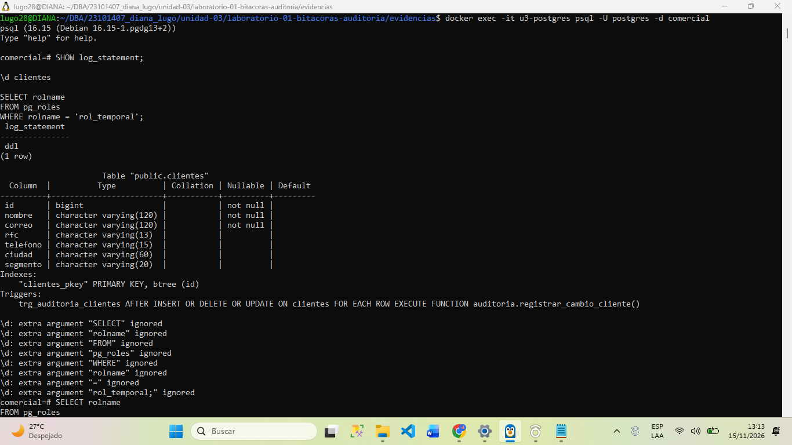
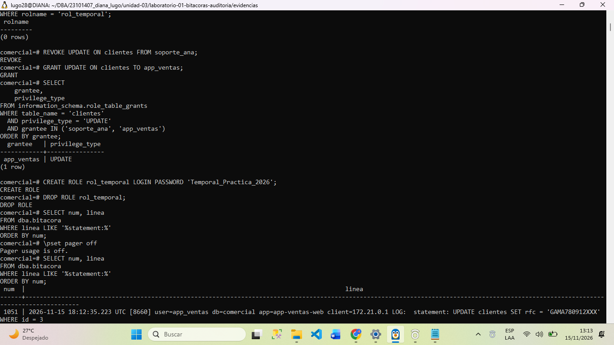
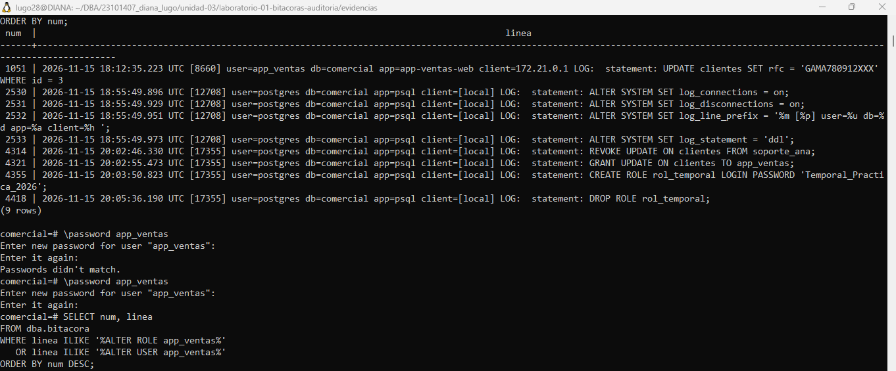

# Actividad 6. Cambios de privilegios y de estructura

**Estudiante:** Lugo Urías Diana Yasmin

**Unidad:** 3

**Laboratorio:** 01 — Bitácoras y auditoría

## ¿Qué hice en esta actividad?

En esta actividad trabajé con los permisos de los usuarios y revisé cómo PostgreSQL registra los cambios que se hacen en la base de datos.

Primero comprobé que la opción `log_statement` estuviera configurada en `ddl`, ya que necesitaba que PostgreSQL registrara las sentencias relacionadas con los cambios de privilegios y de estructura.

Después ejecuté las siguientes instrucciones:

```sql
REVOKE UPDATE ON clientes FROM soporte_ana;

GRANT UPDATE ON clientes TO app_ventas;
```

Con la primera instrucción retiré el permiso de actualización al usuario `soporte_ana`. Aunque este usuario no tenía ese permiso, PostgreSQL ejecutó la instrucción sin mostrar ningún error.

Con la segunda instrucción otorgué el permiso `UPDATE` al usuario `app_ventas`.

Al revisar los permisos, comprobé que `app_ventas` aparecía con el privilegio `UPDATE`, mientras que `soporte_ana` ya no aparecía en el resultado.

La columna `segmento` de la tabla `clientes` ya se encontraba creada desde antes de esta actividad, por lo que no fue necesario agregarla nuevamente.


## Creación y eliminación de un rol temporal

Después realicé una prueba para observar qué sucede cuando se escribe una contraseña directamente en una sentencia SQL.

Para esto creé un rol temporal con la siguiente instrucción:

```sql
CREATE ROLE rol_temporal LOGIN PASSWORD 'Temporal_Practica_2026';
```

PostgreSQL confirmó que el rol se había creado correctamente. Después lo eliminé con:

```sql
DROP ROLE rol_temporal;
```

También comprobé que ambas instrucciones quedaron registradas en la bitácora.


## ¿Qué encontré en la bitácora?

Al consultar los registros de `dba.bitacora`, encontré las instrucciones que había ejecutado:

- `REVOKE UPDATE ON clientes FROM soporte_ana`
- `GRANT UPDATE ON clientes TO app_ventas`
- `CREATE ROLE rol_temporal LOGIN PASSWORD ...`
- `DROP ROLE rol_temporal`

Lo que más me llamó la atención fue que la contraseña utilizada para crear el rol apareció escrita directamente en la bitácora.

Esto significa que, aunque después eliminé el rol temporal, la contraseña no desapareció del registro. Por eso entendí que las bitácoras también pueden contener información que debe protegerse.


## Comparación con el comando \password

Para conocer una forma más segura de cambiar contraseñas, utilicé el siguiente comando:

```sql
\password app_ventas
```

El programa me pidió escribir la nueva contraseña dos veces. En el primer intento las contraseñas no coincidieron, pero en el segundo pude completar el cambio correctamente.

A diferencia de escribir una contraseña directamente en una sentencia SQL, este comando permite que `psql` calcule el verificador SCRAM en el cliente y envíe al servidor ese verificador, en lugar de enviar la contraseña original en texto claro.

Esto ayuda a reducir el riesgo de exponer la contraseña en los registros, aunque el verificador también debe tratarse como información sensible.


## Preguntas de la actividad

**1. ¿Qué tipo de evento es cada una de las tres primeras sentencias: privilegio o estructura?**

- `REVOKE UPDATE ON clientes FROM soporte_ana`: es un cambio de privilegios porque retira un permiso.
- `GRANT UPDATE ON clientes TO app_ventas`: también es un cambio de privilegios porque concede un permiso.
- `ALTER TABLE clientes ADD COLUMN segmento VARCHAR(20)`: es un cambio de estructura porque modifica la tabla al agregar una columna.

**2. ¿Por qué GRANT y REVOKE quedan registrados con log_statement = 'ddl'?**

Porque PostgreSQL considera estas instrucciones como comandos DDL. Por eso, cuando se configura `log_statement = 'ddl'`, también quedan registradas las sentencias que conceden o retiran permisos.

**3. Si la bitácora contiene contraseñas, ¿quién debería poder leerla? Relaciónalo con la gestión de secretos de la Unidad II.**

Considero que la bitácora solamente debería estar disponible para el administrador de la base de datos y para el personal que realmente necesite consultarla por cuestiones de seguridad o mantenimiento.

Esto se relaciona con lo que vimos en la Unidad II sobre la gestión de secretos, porque las contraseñas no deben quedar expuestas ni estar disponibles para cualquier usuario. También es importante limitar los permisos, proteger los archivos y evitar guardar información sensible en lugares donde otras personas puedan consultarla.

## Conclusión

Con esta actividad entendí que las bitácoras son muy útiles porque permiten revisar los cambios que se realizan en una base de datos y saber qué instrucciones se ejecutaron.

Sin embargo, también aprendí que no toda la información que se registra es segura. Una contraseña puede quedar expuesta si se escribe directamente en una sentencia SQL, y eliminar el usuario no significa que esa información desaparezca de la bitácora.

Me pareció importante conocer el comando `\password`, porque permite cambiar una contraseña de una manera más segura al evitar que la contraseña original se envíe al servidor en texto claro.

En conclusión, no basta con tener una bitácora activa. También debemos cuidar quién puede consultarla y qué información estamos guardando en ella.

## Evidencias




