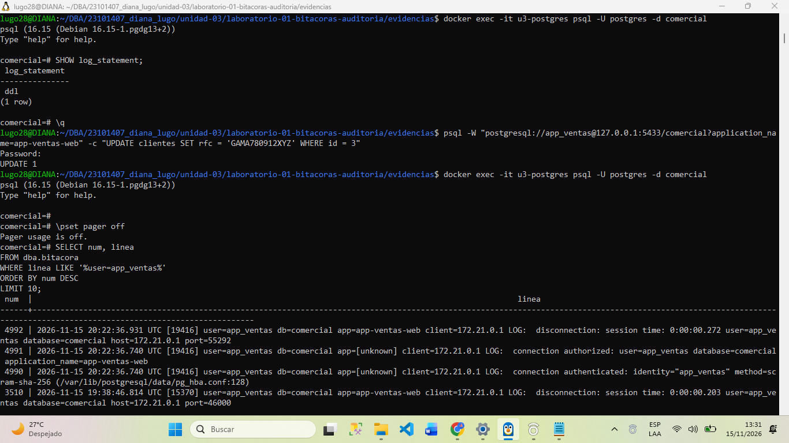
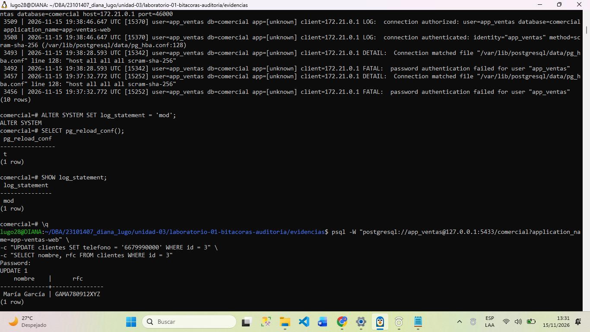
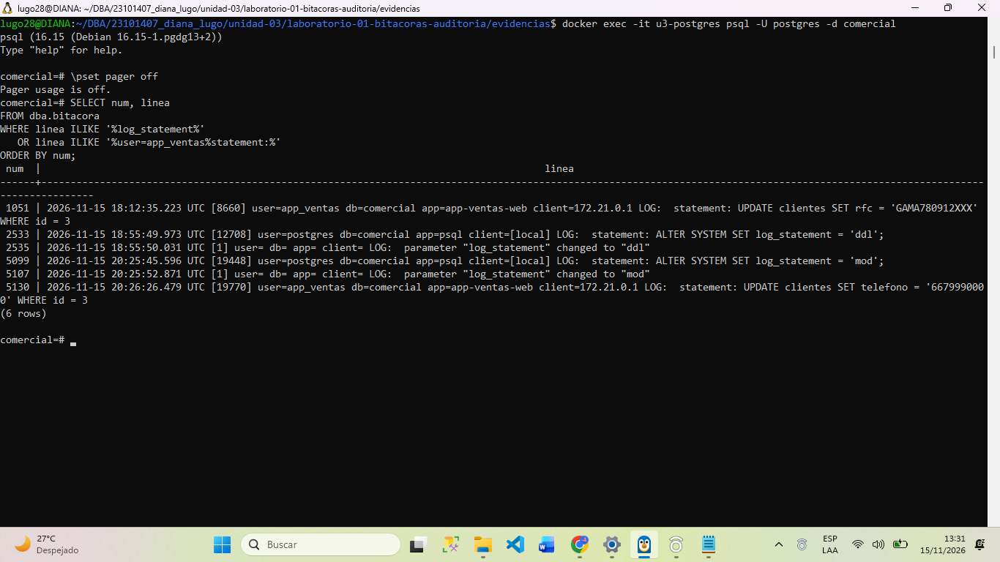

# Actividad 7. Modificaciones de datos: DDL frente a MOD

**Estudiante:** Lugo Urías Diana Yasmin

**Unidad:** 3

**Laboratorio:** 01 — Bitácoras y auditoría

## ¿Qué hice en esta actividad?

En esta práctica quise comprobar qué sucede cuando se realizan cambios en los datos de una tabla y PostgreSQL tiene diferentes niveles de registro configurados.

Primero revisé que la opción `log_statement` estuviera en `ddl`. Después, desde la terminal, me conecté con el usuario `app_ventas` y ejecuté una actualización del RFC del cliente con ID 3.

La instrucción que utilicé fue:

```sql
UPDATE clientes
SET rfc = 'GAMA780912XYZ'
WHERE id = 3;
```

PostgreSQL respondió `UPDATE 1`, por lo que confirmé que el cambio se realizó correctamente.

Después consulté la bitácora y encontré los registros de conexión, autenticación y desconexión del usuario `app_ventas`. Sin embargo, no encontré la sentencia que modificó el RFC.

Esto me permitió comprobar que, cuando se utiliza `log_statement = 'ddl'`, las modificaciones de los datos no quedan registradas como sentencias SQL.


## Cambio de configuración a MOD

Después cambié el nivel de registro para que PostgreSQL también guardara las modificaciones realizadas en los datos.

Utilicé las siguientes instrucciones desde la sesión de administrador:

```sql
ALTER SYSTEM SET log_statement = 'mod';

SELECT pg_reload_conf();
```

Posteriormente comprobé la configuración con:

```sql
SHOW log_statement;
```

El resultado fue `mod`, así que continué con la siguiente parte.


## Realización de una nueva modificación

Para comprobar el nuevo comportamiento, volví a conectarme con el usuario `app_ventas` y ejecuté dos instrucciones: una para modificar el teléfono del cliente y otra para consultar su nombre y RFC.

La modificación fue:

```sql
UPDATE clientes
SET telefono = '6679990000'
WHERE id = 3;
```

También ejecuté una consulta para revisar los datos:

```sql
SELECT nombre, rfc
FROM clientes
WHERE id = 3;
```

Ambas instrucciones se ejecutaron correctamente. Al revisar nuevamente la bitácora encontré la sentencia `UPDATE` que había realizado.

Lo interesante fue que la consulta `SELECT` no apareció, porque el nivel `mod` registra las modificaciones, pero no las operaciones de lectura.


## Revisión de los registros

En la consulta de la bitácora pude identificar la siguiente información:

- **Usuario:** `app_ventas`.
- **Base de datos:** `comercial`.
- **Aplicación:** `app-ventas-web`.
- **Dirección del cliente:** `172.21.0.1`.
- **Sentencia registrada:** actualización del teléfono del cliente con ID 3.

También pude observar que el cambio de configuración de `ddl` a `mod` quedó registrado en la bitácora.


## Preguntas de la actividad

**1. ¿Qué nivel habría registrado la lectura del RFC? ¿Qué costo tendría en un servidor con miles de consultas por minuto?**

Para registrar también las consultas de lectura se tendría que utilizar el nivel `all`, porque este registra todas las sentencias SQL.

Sin embargo, en un servidor que recibe miles de consultas por minuto podría generar una gran cantidad de registros. Esto ocuparía más espacio de almacenamiento y también aumentaría el trabajo necesario para revisar y administrar las bitácoras.

**2. ¿Qué le falta a esta bitácora para revertir el cambio con certeza?**

A la bitácora le falta guardar el valor que tenía el teléfono antes de realizar la modificación y también el valor nuevo después del cambio.

Aunque podemos saber qué sentencia se ejecutó, no tenemos toda la información necesaria para recuperar el dato anterior con seguridad.

Para eso sería necesario contar con un mecanismo de auditoría que guarde los valores anteriores y posteriores de cada modificación.

## Lo que aprendí

Con esta práctica entendí que no todos los niveles de registro sirven para lo mismo.

Con `ddl` se registran los cambios relacionados con la estructura y los permisos, mientras que con `mod` también se registran las modificaciones realizadas en los datos.

Me pareció interesante comprobar que PostgreSQL puede registrar quién realizó un cambio, desde qué aplicación y en qué momento, pero eso no significa que la bitácora guarde automáticamente todos los valores anteriores de los datos.

En conclusión, aprendí que elegir correctamente el nivel de registro es importante para tener información útil sobre lo que sucede en una base de datos, sin generar registros innecesarios.

## Evidencias






