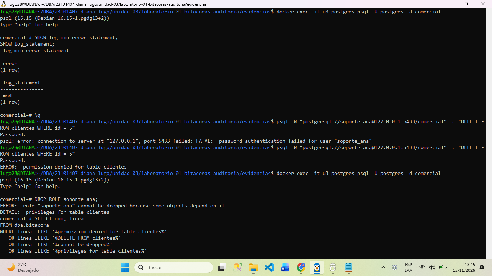
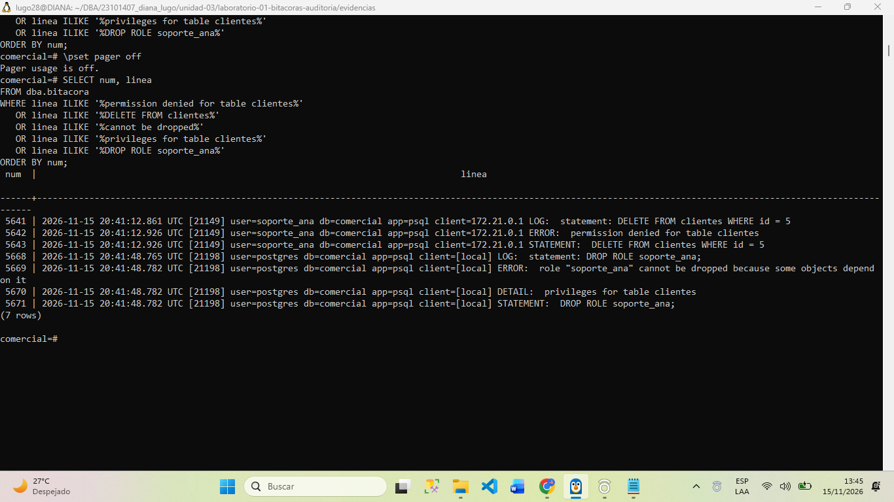

# Actividad 8. Errores y operaciones rechazadas

**Estudiante:** Lugo Urías Diana Yasmin

**Unidad:** 3

**Laboratorio:** 01 — Bitácoras y auditoría

## Objetivo

En esta actividad realicé algunas operaciones que no estaban permitidas para comprobar cómo PostgreSQL rechaza las acciones y cómo quedan registradas en las bitácoras.

La intención fue observar qué sucede cuando un usuario intenta hacer algo para lo que no tiene permisos y cuando se intenta eliminar un rol que todavía tiene privilegios asociados.

## Desarrollo de la actividad

### 1. Intento de eliminar un registro con el usuario soporte_ana

Primero intenté eliminar el registro con el ID 5 utilizando el usuario `soporte_ana`.

El resultado fue:

```text
ERROR: permission denied for table clientes
```

Esto significa que el usuario pudo autenticarse, pero no tenía los permisos necesarios para eliminar información de la tabla `clientes`.

La operación fue rechazada y no se eliminó ningún registro.


### 2. Intento de eliminar el rol soporte_ana

Después, desde la cuenta administradora, intenté ejecutar:

```sql
DROP ROLE soporte_ana;
```

PostgreSQL respondió:

```text
ERROR: role "soporte_ana" cannot be dropped because some objects depend on it
DETAIL: privileges for table clientes
```

El mensaje indica que no se puede eliminar el rol porque todavía tiene privilegios relacionados con la tabla `clientes`.

Esto me permitió comprobar que PostgreSQL también protege la estructura y las dependencias de la base de datos.


### 3. Consulta de los errores en la bitácora

Finalmente, consulté la vista `dba.bitacora` para localizar los mensajes relacionados con los dos intentos.

Utilicé la siguiente consulta:

```sql
SELECT num, linea
FROM dba.bitacora
WHERE linea ILIKE '%permission denied for table clientes%'
   OR linea ILIKE '%DELETE FROM clientes%'
   OR linea ILIKE '%cannot be dropped%'
   OR linea ILIKE '%privileges for table clientes%'
   OR linea ILIKE '%DROP ROLE soporte_ana%'
ORDER BY num;
```

La consulta devolvió siete registros importantes:

- **5641:** PostgreSQL registró la sentencia `DELETE`.
- **5642:** registró el error de permiso denegado.
- **5643:** registró nuevamente la sentencia que provocó el error.
- **5668:** registró el intento de ejecutar `DROP ROLE`.
- **5669:** registró el error que impidió eliminar el rol.
- **5670:** mostró el detalle de los privilegios pendientes.
- **5671:** registró la sentencia `DROP ROLE`.

Con esto comprobé que la bitácora no solamente registra las operaciones exitosas, sino también los intentos que terminan en error.


## Análisis y respuestas

**¿Por qué es importante auditar los intentos fallidos?**

Considero que es importante porque un intento fallido también puede decirnos mucho sobre lo que está pasando en la base de datos. Aunque la operación no se complete, puede tratarse de un error de un usuario o incluso de una actividad sospechosa. Tener ese registro ayuda a revisar lo sucedido y detectar posibles problemas.

**¿Qué diferencia hay entre un error de autenticación y uno de autorización?**

La autenticación sirve para comprobar la identidad del usuario, por ejemplo, mediante su contraseña. Si los datos son incorrectos, no puede entrar.

La autorización ocurre después de iniciar sesión y consiste en revisar qué acciones tiene permitido realizar ese usuario. En mi práctica, `soporte_ana` pudo conectarse correctamente, pero no tenía permiso para eliminar registros. Por eso recibió el error de autorización.

**¿Por qué PostgreSQL no permitió eliminar el rol?**

Porque `soporte_ana` todavía tiene privilegios relacionados con la tabla `clientes`. Antes de eliminarlo sería necesario retirar esos privilegios y revisar que no existan otras dependencias pendientes.

## Conclusión

Con esta actividad pude comprobar que PostgreSQL cuenta con mecanismos para evitar operaciones que no están permitidas. También observé que los errores quedan registrados en la bitácora, incluyendo la sentencia que los provocó y los detalles del problema.

Me pareció importante comprobar que no solamente debemos revisar las operaciones que se realizan correctamente, sino también los intentos rechazados, porque esa información puede ayudar a mantener la seguridad y el control de la base de datos.

##Evidencias




