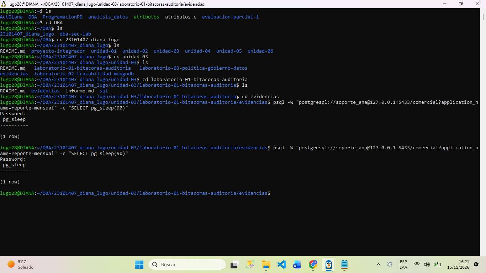
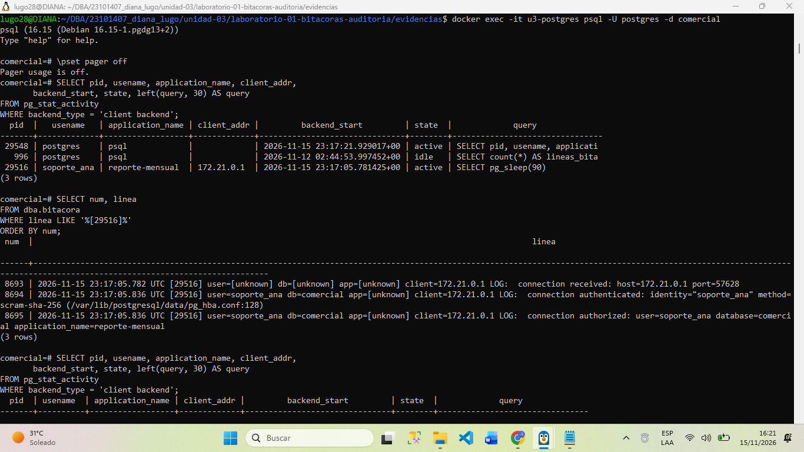
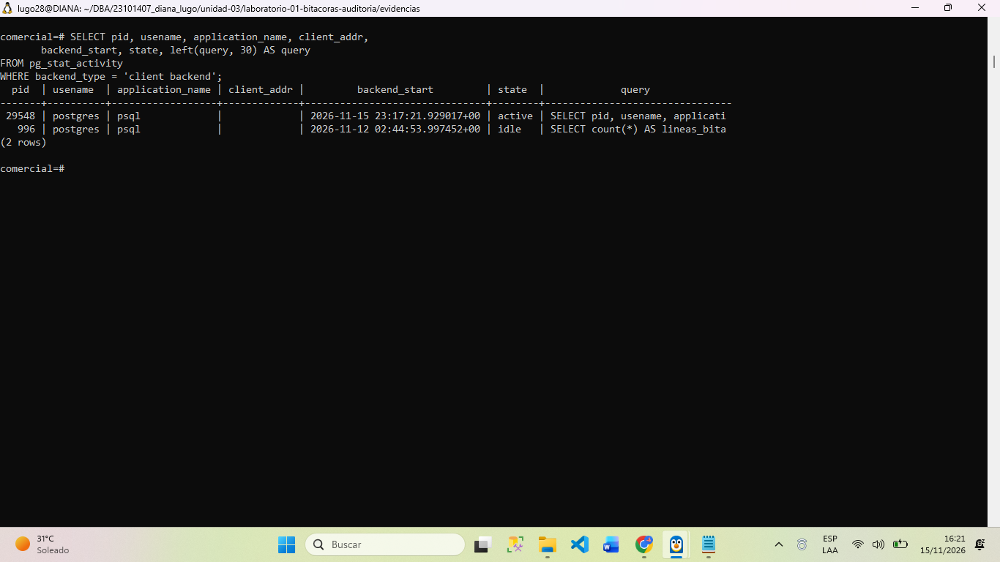

# Actividad 9. Sesiones activas con pg_stat_activity

**Estudiante:** Lugo Urías Diana Yasmin

**Unidad:** 3

**Laboratorio:** 01 — Bitácoras y auditoría

## Objetivo

En esta actividad utilicé la vista `pg_stat_activity` para observar las conexiones activas de PostgreSQL. También revisé cómo identificar una sesión mediante su PID y cómo localizar sus registros en la bitácora, incluso después de que termina la conexión.

## Desarrollo de la actividad

### 1. Simulación de un reporte de larga duración

Primero ejecuté una consulta que mantiene abierta la conexión durante 90 segundos:

```bash
psql -W "postgresql://soporte_ana@127.0.0.1:5433/comercial?application_name=reporte-mensual" -c "SELECT pg_sleep(90)"
```

El comando se ejecutó correctamente y mostró:

```text
 pg_sleep
----------

(1 row)
```

### 2. Consulta de sesiones activas

Mientras el reporte estaba ejecutándose, consulté la vista `pg_stat_activity` desde la sesión administradora.

Utilicé:

```sql
SELECT pid, usename, application_name, client_addr,
       backend_start, state, left(query, 30) AS query
FROM pg_stat_activity
WHERE backend_type = 'client backend';
```

Encontré la siguiente información de la sesión:

| Campo | Resultado |
|---|---|
| PID | 29516 |
| Usuario | soporte_ana |
| Aplicación | reporte-mensual |
| Dirección del cliente | 172.21.0.1 |
| Estado | active |
| Consulta | SELECT pg_sleep(90) |

Con esto pude identificar qué usuario estaba conectado, desde qué dirección llegaba la conexión y qué consulta estaba ejecutando.


### 3. Búsqueda del PID en la bitácora

Después utilicé el PID `29516` para buscar los registros relacionados con esa conexión:

```sql
SELECT num, linea
FROM dba.bitacora
WHERE linea LIKE '%[29516]%'
ORDER BY num;
```

La consulta encontró tres registros:

- **8693:** PostgreSQL recibió la conexión desde `172.21.0.1`.
- **8694:** se autenticó correctamente el usuario `soporte_ana`.
- **8695:** se autorizó la conexión y se identificó la aplicación `reporte-mensual`.

Esto me permitió relacionar la sesión activa con sus registros de bitácora mediante el PID.


### 4. Comprobación después de terminar el reporte

Esperé a que terminara el tiempo de ejecución de `pg_sleep(90)` y repetí la consulta a `pg_stat_activity`.

Esta vez solamente aparecieron dos sesiones de PostgreSQL y ya no se encontraba el PID `29516`.

Esto demuestra que la sesión del reporte dejó de estar activa al terminar la consulta.


## Preguntas y respuestas

**1. ¿Qué columna permite relacionar una sesión con sus líneas de bitácora?**

La columna `pid` de `pg_stat_activity` permite relacionar una sesión con las líneas de bitácora, porque el mismo identificador de proceso aparece entre corchetes en los registros de PostgreSQL.

**2. Después de que termina el reporte, ¿qué fuente conserva evidencia de que existió?**

La bitácora de PostgreSQL, que en esta práctica consulté mediante la vista `dba.bitacora`. Aunque la sesión ya no aparece en `pg_stat_activity`, sus registros de conexión y autenticación permanecen guardados.

**3. ¿Por qué client_addr aparece vacío en la sesión del administrador?**

Porque la sesión administradora se conectó localmente dentro del contenedor mediante `docker exec`. Al no tratarse de una conexión TCP desde otra dirección IP, PostgreSQL muestra `client_addr` vacío.

## Conclusión

Con esta actividad aprendí que `pg_stat_activity` permite observar las conexiones que están activas en un momento determinado. También comprobé que el PID es muy útil para relacionar una sesión con los registros de la bitácora.

Lo que más me llamó la atención fue que, aunque el reporte terminó y desapareció de las sesiones activas, todavía pude encontrar evidencia de su conexión en la bitácora. Esto demuestra por qué es importante conservar los registros para revisar lo que ocurrió anteriormente en la base de datos.


## Evidencia foto



