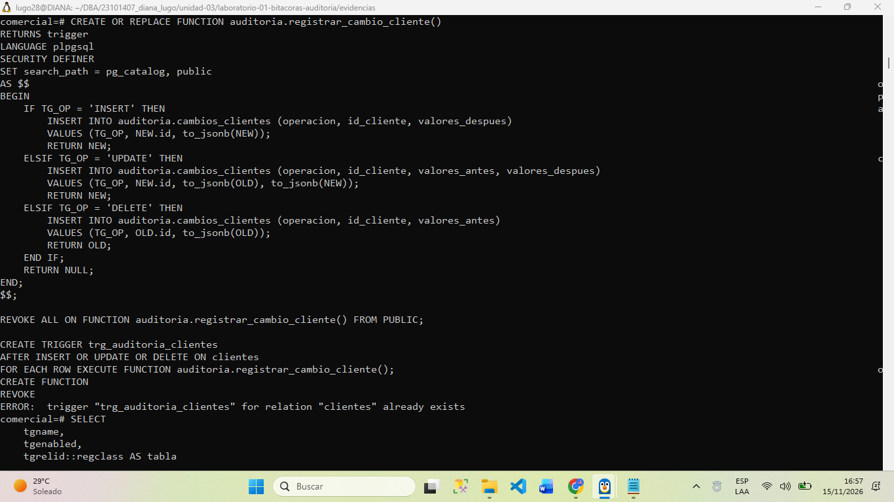
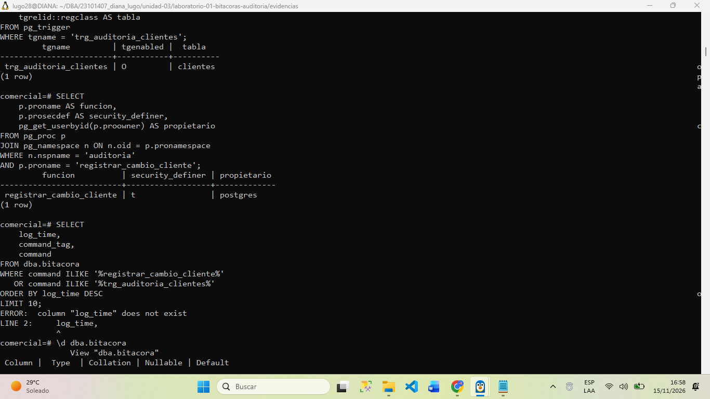
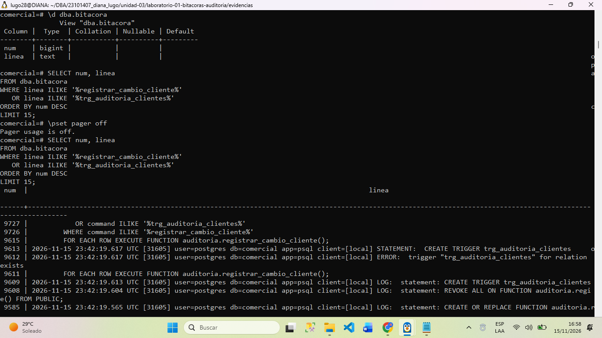
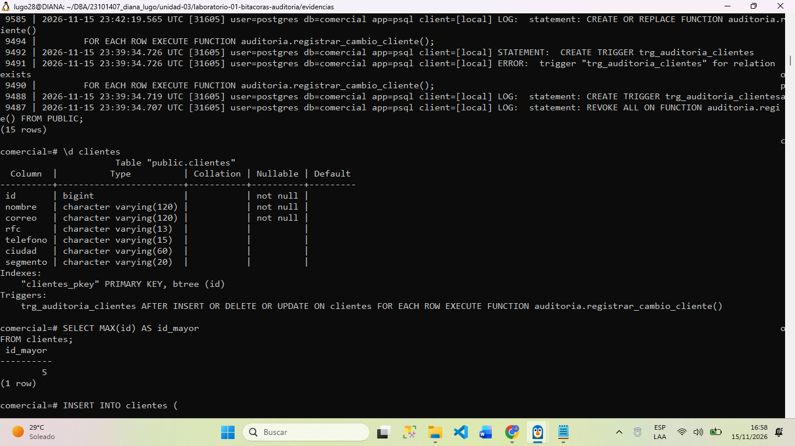
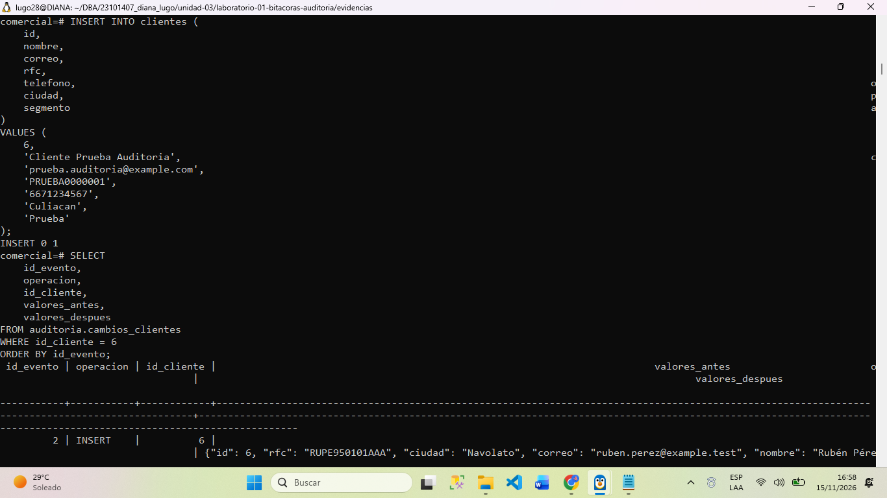
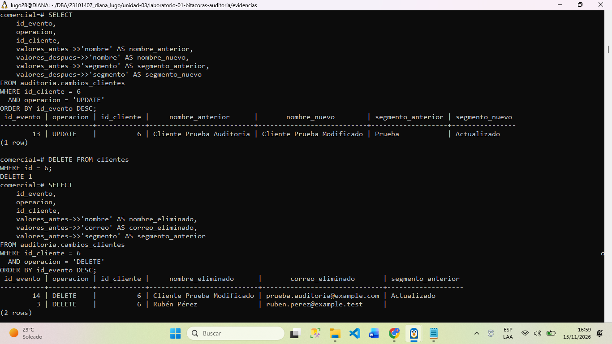

# Actividad 11. Crear la función y el disparador de auditoría

**Estudiante:** Lugo Urías Diana Yasmin

**Unidad:** 3

**Laboratorio:** 01 — Bitácoras y auditoría

## ¿Qué hice en esta actividad?

En esta actividad trabajé con una función y un disparador en PostgreSQL. El objetivo fue conseguir que la base de datos pudiera guardar automáticamente los cambios que se realizan en la tabla `clientes`.

La idea de esta actividad me pareció importante porque, cuando se trabaja con información de clientes, no basta con conocer los datos actuales. También es necesario tener una forma de saber qué cambios se hicieron y conservar la información que existía anteriormente.

Para lograrlo, creé la función `auditoria.registrar_cambio_cliente()`, que se encarga de identificar las operaciones realizadas y guardar la información correspondiente en la tabla `auditoria.cambios_clientes`.

## ¿Cómo funciona la función?

La función contempla tres tipos de operaciones:

- **INSERT:** cuando se agrega un cliente, guarda los datos nuevos.
- **UPDATE:** cuando se modifica un cliente, guarda tanto los datos anteriores como los nuevos.
- **DELETE:** cuando se elimina un cliente, conserva la información que tenía antes de ser eliminado.

También utilicé la opción `SECURITY DEFINER`, para que la función se ejecute con los permisos de su propietario, que en este caso es `postgres`.

Después utilicé `REVOKE ALL ON FUNCTION ... FROM PUBLIC` para evitar que cualquier usuario pueda ejecutar directamente la función.

Finalmente, creé el disparador `trg_auditoria_clientes`, que permite llamar automáticamente a la función cuando se inserta, modifica o elimina un registro de la tabla `clientes`.

## Comprobación de la función y el disparador

Después de ejecutar el código, PostgreSQL mostró que la función se había creado correctamente y que los permisos públicos se habían revocado.

Al intentar crear el disparador, apareció un mensaje indicando que ya existía. En lugar de eliminarlo o modificarlo sin revisar, primero hice una consulta para comprobar su estado.

El resultado mostró lo siguiente:

- **Nombre:** `trg_auditoria_clientes`.
- **Estado:** `O`, que significa que está habilitado.
- **Tabla relacionada:** `clientes`.

También consulté la configuración de la función y confirmé que tenía activada la opción `SECURITY DEFINER` y que su propietario era `postgres`.

Con estas revisiones pude comprobar que la función y el disparador estaban presentes y configurados correctamente.

## Revisión de las bitácoras

También consulté la vista `dba.bitacora` para revisar si PostgreSQL había registrado las operaciones realizadas.

Encontré registros relacionados con:

- La creación o reemplazo de la función.
- La revocación de los permisos públicos.
- El intento de creación del disparador.

También apareció el error que indicaba que el disparador ya existía. Esto me permitió observar que PostgreSQL registra tanto las instrucciones ejecutadas como los errores que se presentan durante el trabajo.

## Pruebas de funcionamiento

Una vez que comprobé que la función y el disparador estaban creados, realicé tres pruebas para asegurarme de que realmente funcionaran.

Para no modificar la información de los clientes que ya existían, utilicé un registro ficticio con el ID `6`.

### 1. Prueba INSERT

Primero agregué un cliente de prueba con los siguientes datos:

- **ID:** 6.
- **Nombre:** Cliente Prueba Auditoria.
- **Correo:** prueba.auditoria@example.com.
- **RFC:** PRUEBA0000001.
- **Teléfono:** 6671234567.
- **Ciudad:** Culiacan.
- **Segmento:** Prueba.

PostgreSQL confirmó que el registro se insertó correctamente con el resultado `INSERT 0 1`.

Después consulté la tabla `auditoria.cambios_clientes` y encontré el evento número **12**, correspondiente a la operación INSERT.

Esto me permitió comprobar que los datos del nuevo cliente se guardaron automáticamente en el historial.

### 2. Prueba UPDATE

Después modifiqué el nombre y el segmento del cliente de prueba.

Realicé los siguientes cambios:

- **Nombre anterior:** Cliente Prueba Auditoria.
- **Nombre nuevo:** Cliente Prueba Modificado.
- **Segmento anterior:** Prueba.
- **Segmento nuevo:** Actualizado.

PostgreSQL mostró el resultado `UPDATE 1`, indicando que el registro se modificó correctamente.

Al consultar nuevamente la tabla de auditoría encontré el evento número **13**.

En este registro pude observar los valores anteriores y los nuevos, por lo que comprobé que la función estaba guardando ambas versiones de la información.

### 3. Prueba DELETE

Por último, eliminé el cliente de prueba utilizando su ID.

PostgreSQL confirmó la operación con el resultado `DELETE 1`.

Después revisé la tabla de auditoría y encontré el evento número **14**, correspondiente a la operación DELETE.

En este registro pude observar que se conservaron los datos del cliente antes de eliminarlo, incluyendo su último nombre y segmento.

Esto fue especialmente importante porque pude comprobar que, aunque el registro ya no se encontraba en la tabla `clientes`, su información seguía disponible en el historial de auditoría.

## Resultados obtenidos

Las tres pruebas se realizaron correctamente y quedaron registradas en la tabla de auditoría.

| Operación | Número de evento | Resultado |
|---|---:|---|
| INSERT | 12 | Correcto |
| UPDATE | 13 | Correcto |
| DELETE | 14 | Correcto |

## ¿Qué aprendí?

Con esta actividad comprendí mejor cómo trabajan las funciones y los disparadores en PostgreSQL.

Antes de realizar las pruebas, sabía que un disparador podía ejecutar una función automáticamente, pero al comprobarlo directamente pude entender mejor su utilidad.

También aprendí que es importante conservar los valores anteriores y posteriores de un registro, ya que esto permite conocer qué información cambió y mantener un historial de las operaciones realizadas.

Otra cosa que me pareció importante fue el uso de `SECURITY DEFINER` y la restricción de permisos, porque la auditoría no solamente debe registrar información, también debe protegerla.

## Conclusión

Al realizar esta actividad pude comprender de una manera más práctica cómo funciona la auditoría dentro de PostgreSQL. No solamente creé una función y un disparador, también comprobé que realmente trabajaran mediante las pruebas de inserción, modificación y eliminación de un cliente.

Uno de los puntos que más me llamó la atención fue que, aunque eliminé el cliente de prueba de la tabla original, sus datos permanecieron guardados en el registro de auditoría. Esto me hizo entender la importancia de conservar un historial, especialmente cuando se trabaja con información que necesita estar protegida y controlada.

Considero que esta actividad fue importante para mi aprendizaje porque me permitió relacionar la seguridad de la base de datos con el seguimiento de las operaciones que realizan los usuarios.

Finalmente, comprobé que las tres operaciones (INSERT, UPDATE y DELETE) se registraron correctamente, cumpliendo así con el objetivo de esta práctica.

## Evidencia foto

