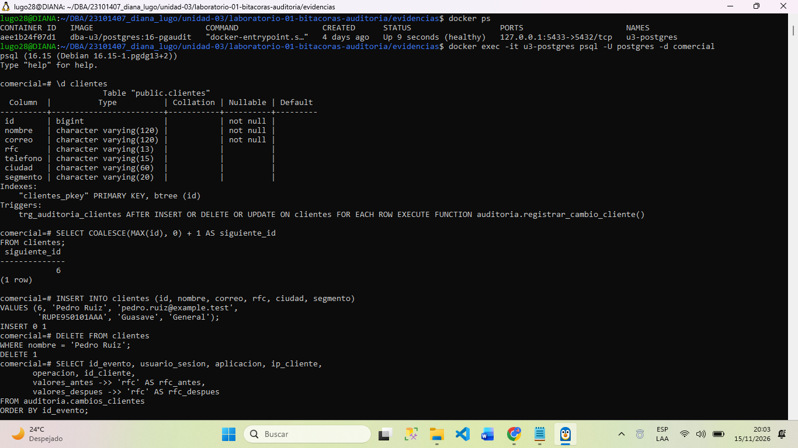
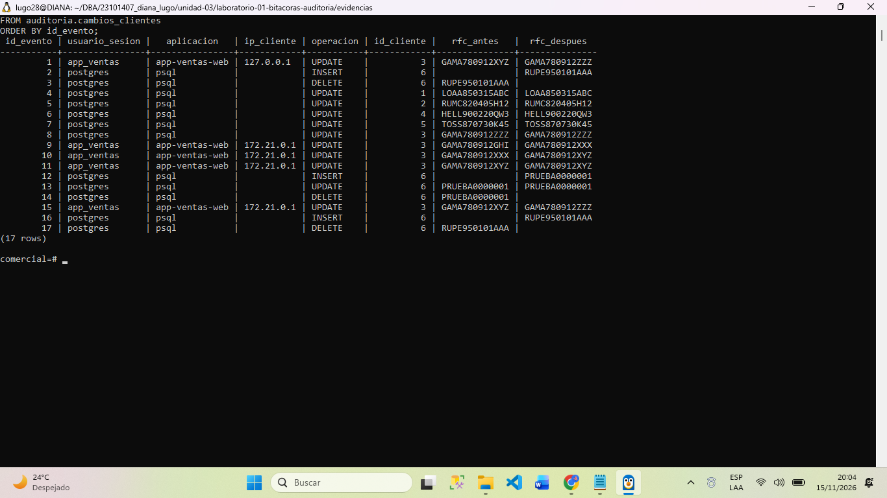

# Actividad 13. Altas y bajas

**Estudiante:** Lugo Urías Diana Yasmin

**Unidad:** 3

**Laboratorio:** 01 — Bitácoras y auditoría

## ¿Qué hice en esta actividad?

En esta actividad realicé el registro y la eliminación de un cliente para comprobar cómo funciona la auditoría cuando se realizan altas y bajas en la tabla `clientes`.

Primero revisé la estructura de la tabla y observé que tenía algunas diferencias respecto a las instrucciones originales. Por ejemplo, no contaba con las columnas `edad` ni `codigo_postal`, y el identificador `id` debía proporcionarse manualmente.

Por eso utilicé el siguiente identificador disponible, que era el número 6, y registré a Pedro Ruiz con sus datos.

Después eliminé al cliente mediante una sentencia `DELETE`. PostgreSQL respondió:

```text
DELETE 1
```

Esto confirmó que el registro fue eliminado correctamente de la tabla principal.

## Revisión de la auditoría

Consulté la tabla `auditoria.cambios_clientes` para revisar las operaciones realizadas.

Encontré los siguientes registros:

| Evento | Operación | ID cliente | RFC anterior | RFC nuevo |
|---|---|---|---|---|
| 16 | INSERT | 6 | — | RUPE950101AAA |
| 17 | DELETE | 6 | RUPE950101AAA | — |

Los dos eventos quedaron registrados correctamente. Esto demuestra que, aunque Pedro Ruiz ya no aparece en la tabla `clientes`, la auditoría conserva evidencia de su existencia y de los datos involucrados en las operaciones.

## Preguntas de la actividad

**1. El cliente Pedro Ruiz ya no existe en clientes. ¿Dónde queda evidencia de que existió y de sus datos?**

La evidencia permanece en la tabla `auditoria.cambios_clientes`. En ella se guardaron los eventos de inserción y eliminación, junto con los valores del registro. De esta manera es posible conocer que el cliente existió y recuperar información de sus datos, aunque ya no esté en la tabla principal.

**2. ¿Por qué ip_cliente está vacía en los eventos 16 y 17?**

Porque las operaciones se realizaron desde una sesión local de PostgreSQL dentro del contenedor, utilizando el usuario administrador `postgres`. En este tipo de conexión, la función `inet_client_addr()` devuelve un valor nulo, ya que no hay una dirección IP remota que registrar.

**3. La política de retención de la Unidad II pedía eliminar datos cuando ya no fueran necesarios. ¿Qué conflicto aparece? ¿Quién debe resolverlo?**

El conflicto consiste en que, por una parte, es necesario eliminar los datos personales cuando ya no se necesitan, pero por otra parte también se requiere conservar evidencia para auditorías e investigaciones.

Considero que la organización debe resolver esta situación mediante sus responsables de seguridad, bases de datos y cumplimiento. Ellos deben establecer cuánto tiempo se conserva la información, qué datos son necesarios y quién puede consultarlos, respetando las políticas de privacidad y retención.

## ¿Qué aprendí?

Aprendí que eliminar un registro de una tabla no significa necesariamente perder toda la evidencia de que existió. Gracias a la función y al disparador de auditoría, fue posible conservar los datos anteriores y registrar tanto el alta como la baja del cliente.

También comprendí que la auditoría debe equilibrarse con las políticas de privacidad y retención de información.

## Conclusión

Esta actividad me permitió comprobar que el mecanismo de auditoría funciona tanto para las inserciones como para las eliminaciones. Aunque Pedro Ruiz fue eliminado de la tabla `clientes`, sus operaciones quedaron registradas en `auditoria.cambios_clientes`.

Con esto entendí la importancia de contar con un historial de cambios, pero también de establecer reglas claras para proteger los datos personales y determinar cuánto tiempo deben conservarse.

## Evidencia foto


