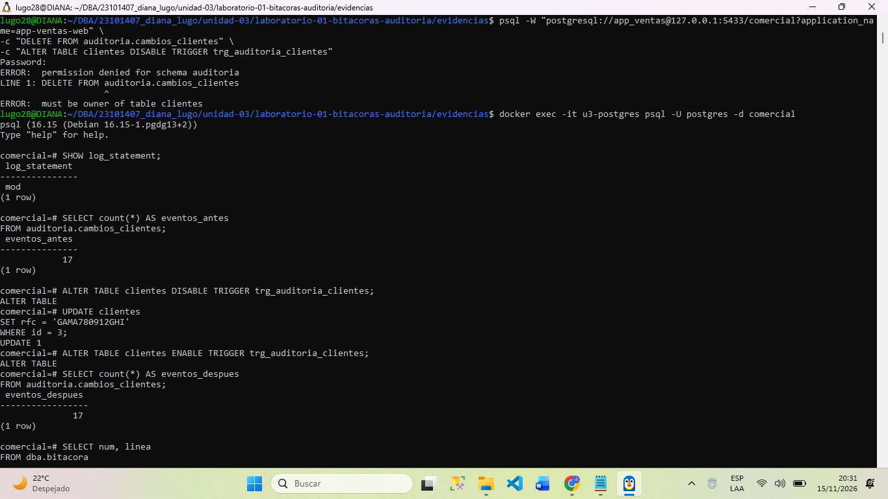
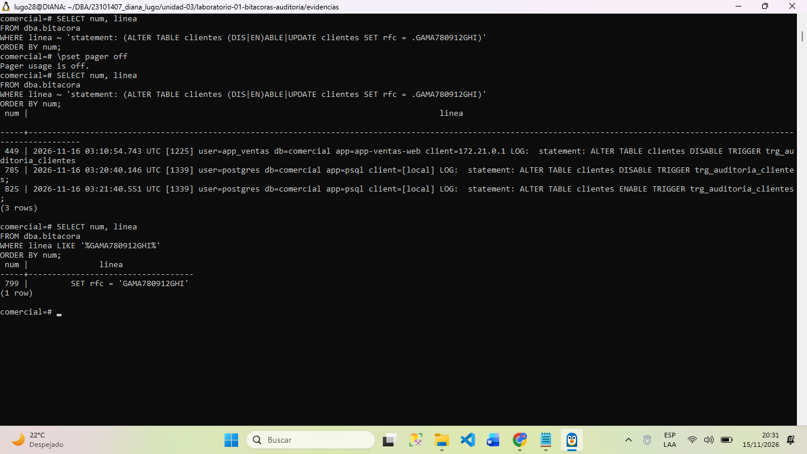

# Actividad 14. Intentar manipular la auditoría

**Estudiante:** Lugo Urías Diana Yasmin

**Unidad:** 3

**Laboratorio:** 01 — Bitácoras y auditoría

## ¿Qué hice en esta actividad?

En esta actividad comprobé qué tan fácil sería alterar o evitar el registro de auditoría desde una cuenta de aplicación y qué sucede cuando una persona con permisos de administrador desactiva el disparador encargado de registrar los cambios.

Primero intenté eliminar los registros de la tabla `auditoria.cambios_clientes` y desactivar el disparador utilizando la cuenta `app_ventas`.

Los dos intentos fueron rechazados por PostgreSQL:

- Al intentar eliminar los registros, recibí el error `permission denied for schema auditoria`.
- Al intentar desactivar el disparador, recibí el error `must be owner of table clientes`.

Esto demuestra que la cuenta de la aplicación no tiene permisos suficientes para manipular directamente la auditoría ni modificar la estructura de la tabla de clientes.

Después realicé la prueba desde la cuenta de administrador. Desactivé temporalmente el disparador `trg_auditoria_clientes`, modifiqué el RFC del cliente con ID 3 y posteriormente volví a activar el disparador.

La modificación se realizó correctamente:

```sql
UPDATE clientes
SET rfc = 'GAMA780912GHI'
WHERE id = 3;
```

## Comprobación de la tabla de auditoría

Antes de desactivar el disparador, la tabla de auditoría tenía 17 eventos.

Después de realizar la modificación y activar nuevamente el disparador, el conteo continuó siendo de 17 eventos.

Esto significa que el cambio del RFC no generó un nuevo registro en `auditoria.cambios_clientes`, porque el disparador estaba desactivado cuando se ejecutó el `UPDATE`.

## Revisión de la bitácora del servidor

También consulté `dba.bitacora` para buscar evidencia de las operaciones realizadas.

Encontré los siguientes registros:

| Línea | Operación identificada |
|---|---|
| 449 | Intento de `app_ventas` de desactivar el disparador. |
| 785 | El administrador desactivó el disparador. |
| 799 | Se registró la modificación del RFC a `GAMA780912GHI`. |
| 825 | El administrador volvió a activar el disparador. |

Aunque el cambio no apareció en la tabla de auditoría, sí encontré evidencia de la modificación en la bitácora del servidor.

Esto me permitió comprobar que ambos mecanismos cumplen funciones diferentes y que revisar solamente la tabla de auditoría no siempre es suficiente.

## Preguntas de la actividad

**1. ¿Qué evidencia permite detectar que hubo un cambio sin auditar?**

La evidencia se encuentra al comparar el conteo de eventos de la tabla de auditoría con los registros de la bitácora del servidor. En esta práctica, la tabla permaneció en 17 eventos, pero la bitácora mostró que el administrador desactivó el disparador, modificó el RFC y después lo volvió a activar.

**2. ¿Qué control administrativo (no técnico) reduciría este riesgo?**

Una medida importante sería separar las responsabilidades entre las personas que administran la base de datos y quienes supervisan o custodian las evidencias. También sería conveniente establecer revisiones periódicas, autorizaciones para realizar cambios importantes y dejar constancia de quién los solicita y quién los ejecuta.

**3. Relaciona esta actividad con el principio de separación de funciones de Unidad II.**

Esta actividad se relaciona directamente con la separación de funciones porque demuestra que una sola persona con privilegios de administrador puede desactivar los controles de auditoría y realizar cambios sin que estos queden registrados en la tabla correspondiente.

Por eso, no conviene que una misma persona tenga el control total de la base de datos y también sea responsable de supervisar sus propios movimientos. Las funciones deben distribuirse para que exista una revisión independiente y se reduzca el riesgo de manipulación.

## ¿Qué aprendí?

Aprendí que tener una tabla de auditoría y un disparador no garantiza por sí solo que todos los cambios queden registrados. Si alguien tiene privilegios suficientes, puede desactivar temporalmente ese mecanismo.

También comprendí la importancia de conservar las bitácoras del servidor y de contar con controles administrativos que permitan revisar las acciones de los administradores.

## Conclusión

Con esta actividad comprobé que la auditoría puede ser manipulada por una cuenta con privilegios elevados. La cuenta `app_ventas` no pudo modificar los registros ni desactivar el disparador, pero el administrador sí pudo hacerlo.

Aunque el cambio no quedó registrado en la tabla de auditoría, la bitácora del servidor conservó evidencia de las operaciones realizadas. Esto demuestra la importancia de utilizar diferentes mecanismos de registro y, sobre todo, de separar las responsabilidades para evitar que una sola persona tenga el control absoluto sobre la información y sus evidencias.

## Evidencia foto


