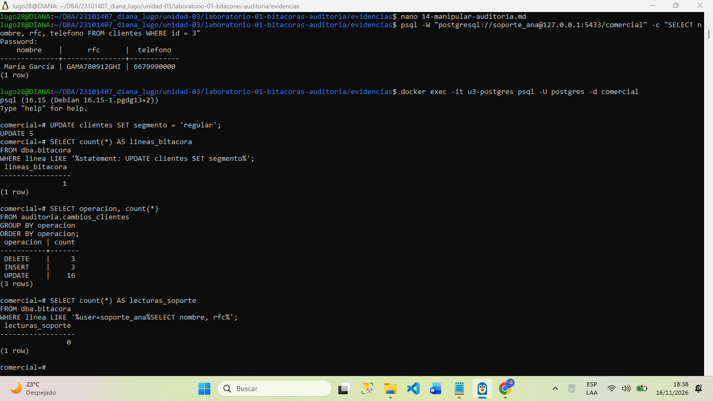

# Actividad 15. Límites: lecturas y volumen

**Estudiante:** Lugo Urías Diana Yasmin

**Unidad:** 3

**Laboratorio:** 01 — Bitácoras y auditoría

## ¿Qué hice en esta actividad?

En esta actividad trabajé con dos situaciones diferentes para conocer mejor los límites de la auditoría en PostgreSQL. Primero revisé información de un cliente utilizando la cuenta `soporte_ana` y después realicé una modificación que afectó a todos los registros de la tabla `clientes`.

Comencé consultando el nombre, RFC y teléfono del cliente con ID 3. La consulta se realizó correctamente y pude visualizar los datos de María García.

Después ingresé como administrador y ejecuté la siguiente instrucción:

```sql
UPDATE clientes SET segmento = 'regular';
```

El resultado fue `UPDATE 5`, lo que significa que se modificaron los cinco clientes que existen actualmente en la tabla. Como no utilicé `WHERE`, la modificación se aplicó a todos los registros.

## Resultados obtenidos

Primero revisé la bitácora para saber cuántas veces se había registrado el cambio masivo. El resultado fue de **1 línea**.

Esto me permitió entender que la bitácora guarda la instrucción SQL ejecutada, no necesariamente un registro separado por cada cliente afectado.

Después consulté la tabla de auditoría y obtuve los siguientes resultados:

| Operación | Cantidad de registros |
|---|---:|
| DELETE | 3 |
| INSERT | 3 |
| UPDATE | 16 |

Al revisar los resultados, observé que los eventos UPDATE aumentaron de 11 a 16. Esto ocurrió porque el disparador registró individualmente el cambio realizado en cada uno de los cinco clientes.

Por último, busqué si la consulta que hice con `soporte_ana` había quedado registrada en la bitácora. El resultado fue `0`, por lo que no encontré evidencia de esa lectura.

## ¿Qué significan estos resultados?

Lo que más me llamó la atención fue que una consulta permitió visualizar información personal de un cliente, pero no dejó un registro en los mecanismos de auditoría que tenemos configurados.

Esto sucede porque `log_statement = 'mod'` registra instrucciones que modifican información, pero no las consultas SELECT. Además, el disparador que creamos solamente registra operaciones INSERT, UPDATE y DELETE.

También pude observar que la bitácora y la tabla de auditoría funcionan de manera diferente: la primera registró una sola instrucción, mientras que la segunda guardó un evento por cada cliente modificado.

## Preguntas de la actividad

**1. Si clientes tuviera un millón de registros, ¿qué ocurriría con la auditoría tras un UPDATE sin WHERE?**

Si la tabla tuviera un millón de clientes y ejecutara un UPDATE sin WHERE, se modificarían todos los registros. El disparador intentaría guardar un millón de eventos en la tabla de auditoría.

Esto provocaría que la tabla creciera demasiado y necesitara más espacio de almacenamiento. También podría afectar el rendimiento de la base de datos. Por eso es importante revisar bien las instrucciones antes de ejecutarlas, especialmente cuando pueden afectar muchos registros.

**2. Propón quién podría autorizar la depuración de auditoria.cambios_clientes.**

Considero que esta responsabilidad debería estar en manos del encargado de seguridad de la información, con la participación del área de auditoría o cumplimiento.

No sería conveniente que cualquier administrador pudiera eliminar registros por su cuenta. Lo mejor sería contar con una autorización previa y reglas claras sobre cuánto tiempo deben conservarse las evidencias y cuándo pueden eliminarse.

**3. ¿Por qué log_statement = 'all' puede convertir la bitácora en un nuevo depósito de datos sensibles?**

Porque esta configuración registra todas las consultas que se realizan en la base de datos. Esto incluye aquellas que muestran nombres, RFC, teléfonos y otra información personal.

El problema es que las bitácoras terminarían guardando datos que también necesitan protección. Si alguien consiguiera acceso a esos archivos, podría encontrar información sensible. Además, se generaría una gran cantidad de registros que necesitarían almacenamiento y supervisión.

## ¿Qué aprendí?

Con esta actividad comprendí que no basta con tener una tabla de auditoría para pensar que toda la información está protegida. También existen operaciones, como las consultas SELECT, que pueden mostrar datos importantes sin dejar evidencia con la configuración que utilizamos.

Aprendí que los cambios masivos deben manejarse con mucho cuidado, porque pueden generar una gran cantidad de registros de auditoría. También entendí que registrar absolutamente todo no siempre es la mejor solución, ya que las propias bitácoras pueden terminar almacenando información que debe protegerse.

## Conclusión

Esta práctica me ayudó a entender que la auditoría tiene límites y que es necesario conocerlos para poder proteger mejor la información.

Pude comprobar que una modificación masiva quedó registrada una sola vez en la bitácora, pero generó cinco eventos individuales en la tabla de auditoría. También confirmé que la consulta de datos sensibles no dejó evidencia con la configuración actual.

Me quedo con la idea de que una buena auditoría no consiste solamente en guardar muchos registros, sino en saber qué información necesitamos registrar, cómo protegerla y cuánto tiempo debemos conservarla.

## Evidencia foto

