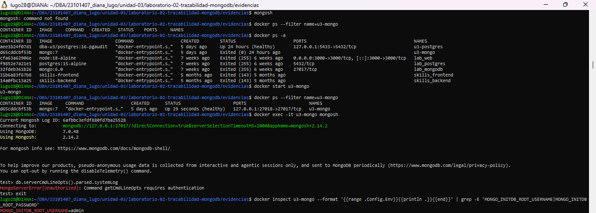
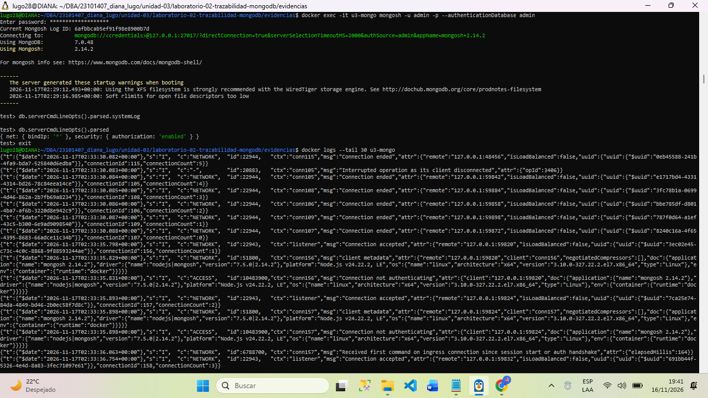

# Actividad 1. Lo que no existe en esta edición

**Estudiante:** Lugo Urías Diana Yasmin  
**Unidad:** 3  
**Laboratorio:** 02 — Trazabilidad en MongoDB

## ¿Qué hice en esta actividad?

En esta primera actividad revisé la versión y la configuración de mi servidor MongoDB para conocer qué mecanismos de trazabilidad tengo disponibles.

El propósito fue identificar qué edición estoy utilizando y comprobar si cuenta con auditoría nativa. También revisé dónde se guardan los registros del servidor y qué información puedo obtener con las herramientas disponibles en MongoDB Community.

## 1. Identificación de la edición de MongoDB

Primero consulté la versión del servidor mediante:

```javascript
db.version()
```

El resultado obtenido fue:

```text
7.0.43
```

Después revisé los módulos incluidos en la instalación:

```javascript
db.adminCommand({ buildInfo: 1 }).modules
```

El resultado fue:

```javascript
[]
```

Con estos resultados identifiqué que estoy trabajando con **MongoDB Community Edition**, versión 7.0.43. El arreglo vacío indica que no está presente el módulo Enterprise.

Por lo tanto, mi servidor no cuenta con la función de auditoría nativa disponible en las ediciones Enterprise y Atlas.

## 2. Revisión de la configuración del servidor

Después consulté las opciones con las que inició MongoDB:

```javascript
db.serverCmdLineOpts().parsed
```

Obtuve el siguiente resultado:

```javascript
{
  net: { bindIp: '*' },
  security: { authorization: 'enabled' }
}
```

Esto me permitió comprobar dos aspectos importantes:

- `bindIp: '*'`: el servidor escucha en todas las interfaces de red disponibles dentro del contenedor.
- `authorization: 'enabled'`: el control de acceso mediante autenticación está habilitado.

También revisé la propiedad `systemLog`, pero no devolvió información. Esto significa que no aparece una configuración explícita de bitácora en las opciones de inicio consultadas.

## 3. ¿Dónde se guardan los registros del servidor?

Para comprobar dónde podía consultar los registros, salí de MongoDB y utilicé el siguiente comando desde Ubuntu:

```bash
docker logs --tail 30 u3-mongo
```

El comando mostró diferentes eventos del servidor en formato JSON, entre ellos:

- Eventos de conexión y desconexión del componente `NETWORK`.
- Eventos relacionados con el acceso y la autenticación del componente `ACCESS`.
- Información sobre los clientes que se conectan al servidor.

Con esto comprobé que, en mi despliegue de Docker, los registros de MongoDB se encuentran disponibles mediante la salida estándar del contenedor.

Esto coincide con lo explicado en el material del laboratorio: cuando no se configura un archivo mediante `systemLog.destination` y `systemLog.path`, los registros pueden enviarse a la salida estándar del proceso.

## 4. ¿Qué registraría la auditoría nativa?

De acuerdo con el material de referencia REF-U3-04, MongoDB Enterprise y Atlas permiten registrar cuatro categorías principales de eventos:

1. **Cambios de esquema (DDL):** modificaciones relacionadas con la estructura de la base de datos.
2. **Eventos de conjuntos de réplicas y clústeres fragmentados:** eventos relacionados con estos entornos.
3. **Autenticación y autorización:** actividades relacionadas con el acceso y los permisos de los usuarios.
4. **Operaciones CRUD:** creación, consulta, actualización y eliminación de documentos. Para registrar estas operaciones se requiere habilitar `auditAuthorizationSuccess: true`.

Estas capacidades no están disponibles mediante la auditoría nativa en MongoDB Community Edition.

## 5. ¿Qué tendría que evaluar una organización antes de migrar o adquirir Enterprise?

Considero que una organización no debería cambiar de edición únicamente por contar con auditoría sin antes analizar sus necesidades.

Tendría que evaluar el costo de las licencias o del servicio Atlas, los requisitos de seguridad y cumplimiento, el volumen de operaciones, la infraestructura disponible y el posible impacto de una migración.

También sería importante comparar esos costos con los mecanismos que ya ofrece MongoDB Community, como el perfilador y las bitácoras del servidor.

La decisión tendría que basarse en las necesidades reales de trazabilidad y en el nivel de evidencia que la organización necesita conservar.

## Conclusión

Esta actividad me permitió conocer mejor las capacidades y limitaciones de MongoDB Community Edition. Comprobé que mi servidor utiliza la versión 7.0.43, que la autenticación está habilitada y que puedo consultar los registros del servidor mediante Docker.

También comprendí que tener registros de conexiones y operaciones del servidor no significa contar con una auditoría nativa completa. Aunque MongoDB Community ofrece herramientas útiles para revisar actividades, no permite disponer de todas las categorías de auditoría que ofrecen Enterprise y Atlas.

Lo más importante que me llevo de esta actividad es que debemos reconocer las limitaciones de cada herramienta y no presentar como evidencia algo que realmente no podemos comprobar. Si necesitamos conocer con certeza quién modificó un dato, cuándo lo hizo y desde dónde, debemos considerar las capacidades reales de nuestra edición y sus mecanismos de trazabilidad.

##Evidencia foto


