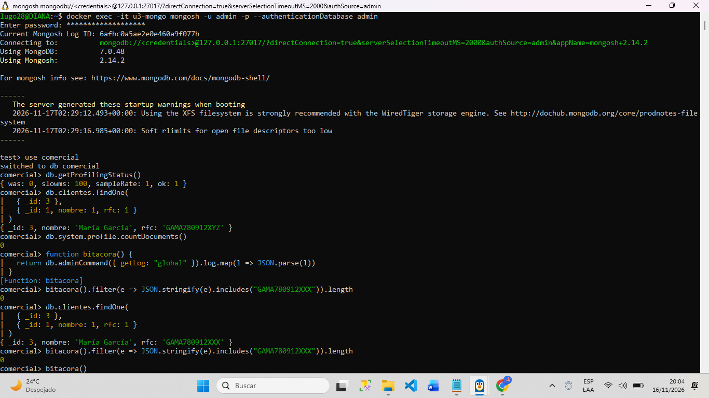
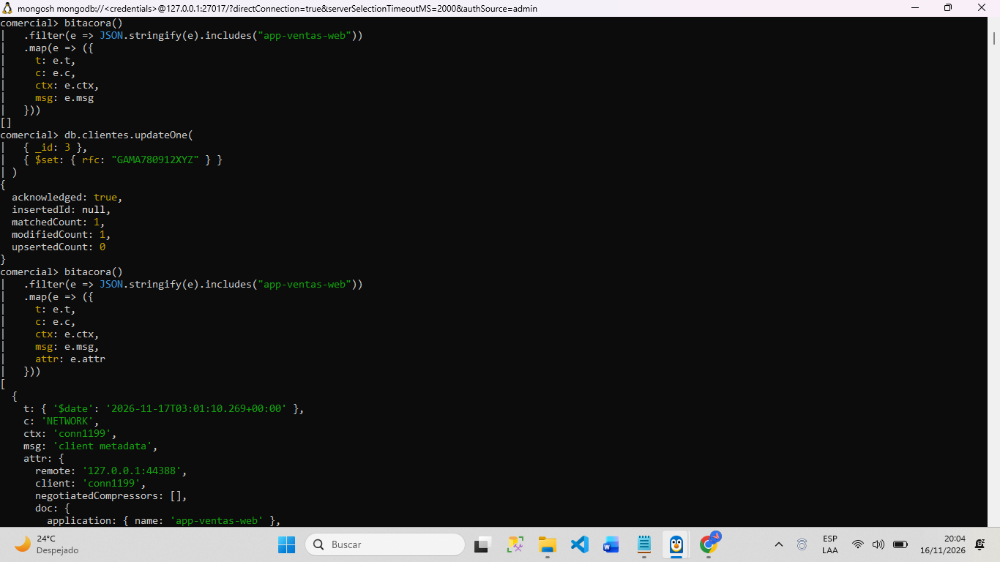
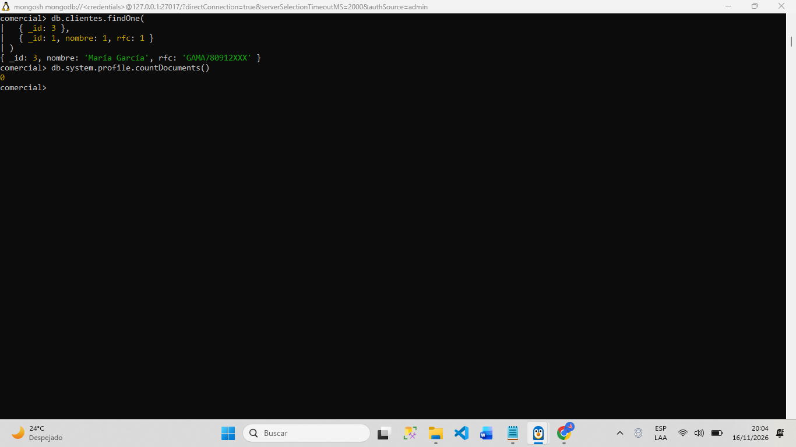
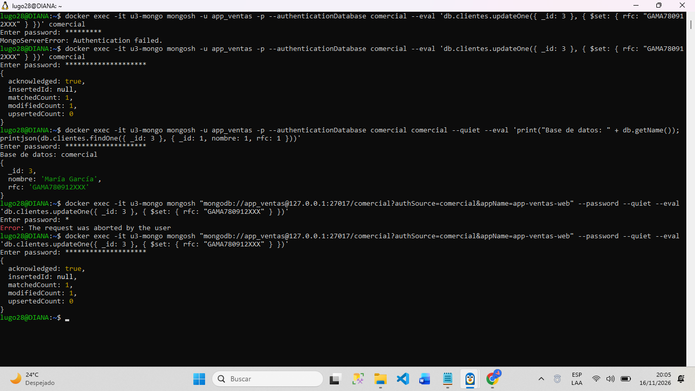

# Actividad 2. El incidente sin perfilado

**Estudiante:** Lugo Urías Diana Yasmin

**Unidad:** 3

**Laboratorio:** 02 — Trazabilidad en MongoDB

## ¿Qué hice en esta actividad?

En esta actividad revisé qué sucede cuando se modifica información en MongoDB mientras el perfilador se encuentra apagado.

Primero consulté el estado del perfilador en la base de datos `comercial` mediante `db.getProfilingStatus()`. El resultado mostró `was: 0`, por lo que confirmé que estaba desactivado.

Después consulté el registro de María García, identificada con el número 3, para conocer su RFC original. Posteriormente realicé una actualización desde el usuario `app_ventas`, cambiando el RFC de `GAMA780912XYZ` a `GAMA780912XXX`.

La operación se realizó correctamente, ya que MongoDB devolvió `acknowledged: true`, `matchedCount: 1` y `modifiedCount: 1`.

## ¿Qué resultados obtuve?

Al revisar la colección `system.profile`, obtuve un total de cero documentos. Esto significa que no se guardó evidencia de la operación mediante el perfilador.

También busqué el RFC nuevo en la bitácora del servidor y no encontré coincidencias.

Sin embargo, al consultar nuevamente el documento del cliente, comprobé que el RFC sí había cambiado y que su valor actual era `GAMA780912XXX`.

Después revisé los registros relacionados con el nombre de aplicación `app-ventas-web`. Encontré varios eventos de conexión y tres autenticaciones exitosas correspondientes al usuario `app_ventas`, en la base de datos `comercial`, mediante el mecanismo `SCRAM-SHA-256`.

## Respuestas a las preguntas

**1. ¿Puedes demostrar qué cambió? ¿Y quién se conectó a esa hora?**

Sí puedo demostrar el cambio porque consulté el documento antes y después de la actualización. El RFC pasó de `GAMA780912XYZ` a `GAMA780912XXX`.

También pude identificar que el usuario `app_ventas` se autenticó correctamente en la base `comercial`. No obstante, los registros consultados no permiten relacionar una conexión específica con la operación que modificó el RFC.

**2. ¿Por qué mongosh abre varias conexiones para una sola instrucción? ¿Cuál es la que se autentica?**

MongoDB utiliza el controlador de conexión de `mongosh`, que puede establecer varias conexiones para comunicarse con el servidor y mantener conexiones disponibles.

En los registros encontré las conexiones `conn1199`, `conn1200`, `conn1201` y `conn1202`. Las conexiones `conn1200`, `conn1201` y `conn1202` mostraron el mensaje `Successfully authenticated`, correspondiente al usuario `app_ventas`.

No es posible asegurar cuál de ellas ejecutó la actualización, porque no contamos con un registro de la operación CRUD que permita relacionarla con una conexión específica.

## ¿Qué aprendí?

Con esta actividad comprendí que no es lo mismo registrar una conexión que registrar las operaciones realizadas dentro de una base de datos.

Aunque pude comprobar que el RFC cambió y que el usuario de la aplicación logró autenticarse, no encontré un registro que demostrara directamente la operación realizada.

Esto muestra una limitación importante de trabajar con el perfilador apagado en MongoDB Community: podemos consultar información actual y algunos eventos del servidor, pero no reconstruir completamente lo que ocurrió.

## Conclusión

La actividad me permitió comprobar que una modificación puede realizarse correctamente sin que exista un registro detallado de ella en `system.profile`.

También observé que los registros del servidor ayudan a identificar conexiones y autenticaciones, pero no sustituyen una auditoría completa de las operaciones.

Por eso considero importante configurar mecanismos de trazabilidad adecuados, revisar los permisos de los usuarios y conservar evidencias que permitan investigar cambios cuando sea necesario.
## Evidencia foto

