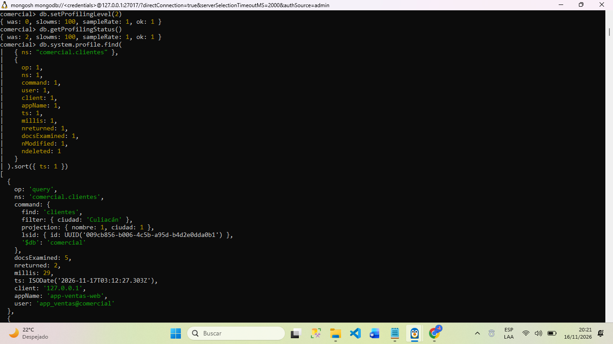
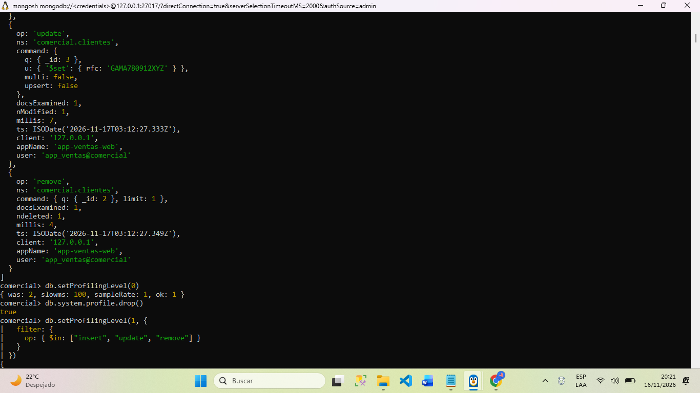
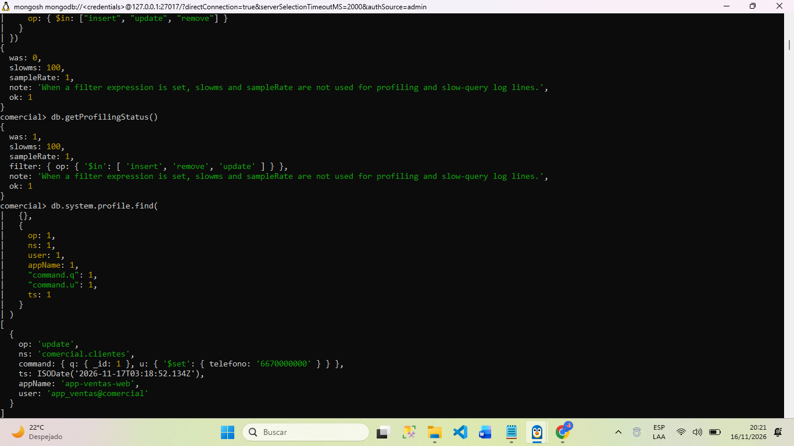

# Actividad 4. Reducir el volumen con un filtro

**Estudiante:** Lugo Urías Diana Yasmin  
**Unidad:** 3  
**Laboratorio:** 02 — Trazabilidad en MongoDB

## ¿Qué hice en esta actividad?

En esta actividad trabajé con el perfilador de MongoDB para aprender a controlar la información que se guarda en los registros. La idea fue evitar que se almacenaran todas las operaciones y dejar únicamente aquellas que realizan cambios en los datos.

Primero desactivé el perfilador y eliminé los registros anteriores de la colección `system.profile`, para comenzar la prueba desde cero.

Después lo configuré en nivel 1 con un filtro que permite registrar solamente las operaciones `insert`, `update` y `remove`. De esta manera, las consultas normales quedan fuera del registro.

## Prueba realizada

Para comprobar que el filtro funcionaba, utilicé la cuenta de la aplicación `app_ventas` y realicé dos operaciones sobre la colección `clientes`.

Primero ejecuté una consulta para buscar al cliente con el identificador `_id: 1`. Después actualicé su número de teléfono a `6670000000`.

MongoDB confirmó que la actualización se realizó correctamente, ya que encontró el registro y modificó su información.

Posteriormente regresé a la sesión de DBA y consulté la colección `system.profile`. Ahí pude observar que solamente apareció la operación de actualización. La consulta de búsqueda no se registró porque el filtro no permite guardar operaciones de lectura.

También pude identificar el nombre de la colección, el usuario que realizó el cambio y la aplicación desde la que se ejecutó.

## ¿Qué evidencia se pierde y qué se gana al aplicar el filtro?

Al utilizar este filtro se pierde información sobre las consultas que realizan los usuarios, por ejemplo, las operaciones `find`. Esto puede ser una desventaja si en algún momento necesitamos investigar qué información fue consultada.

Sin embargo, también tiene una ventaja importante: los registros contienen menos información y es más sencillo encontrar las operaciones que realmente modifican los datos. Así podemos concentrarnos en las inserciones, actualizaciones y eliminaciones sin tener que revisar tantas consultas.

## ¿Qué filtro utilizaría si solo me interesaran las operaciones sobre la colección clientes?

Utilizaría el campo `ns`, que permite indicar el nombre de la base de datos y de la colección que quiero supervisar.

El filtro sería el siguiente:

```javascript
db.setProfilingLevel(1, {
  filter: { ns: "comercial.clientes" }
})
```

Con esta configuración podría concentrarme en las operaciones realizadas sobre la colección `clientes` de la base de datos `comercial`, sin importar si son consultas o modificaciones.

## Conclusión

Con esta actividad comprendí que el perfilador de MongoDB se puede configurar de acuerdo con la información que necesitamos revisar. No siempre es necesario guardar todas las operaciones, ya que podemos utilizar filtros para mantener registros más específicos y fáciles de analizar.

También aprendí que reducir la cantidad de registros implica dejar fuera cierta información, como las consultas de lectura. Por eso, considero importante elegir el filtro pensando en el objetivo de la supervisión, buscando un equilibrio entre tener suficiente evidencia y evitar almacenar información innecesaria.


## Evidencia foto





