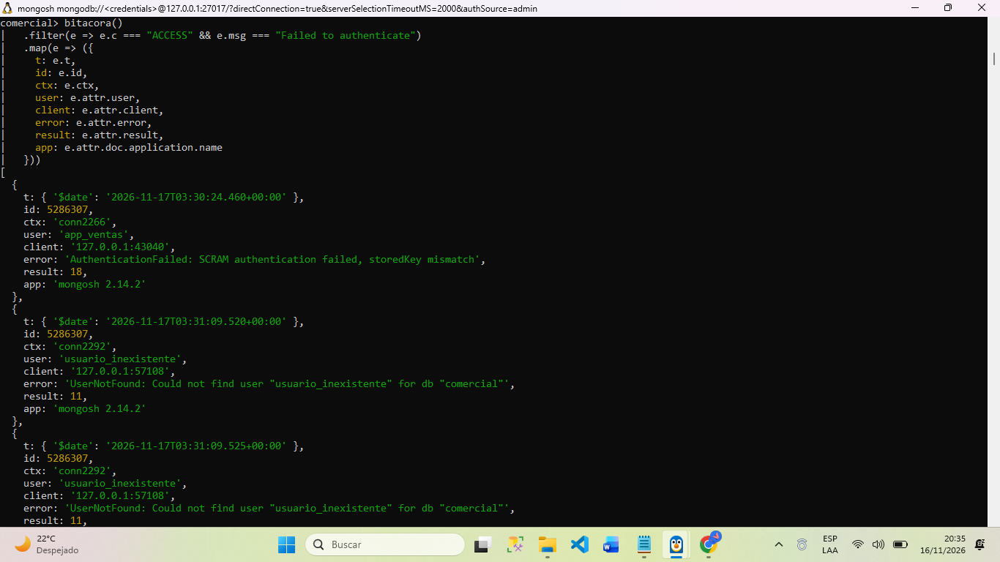
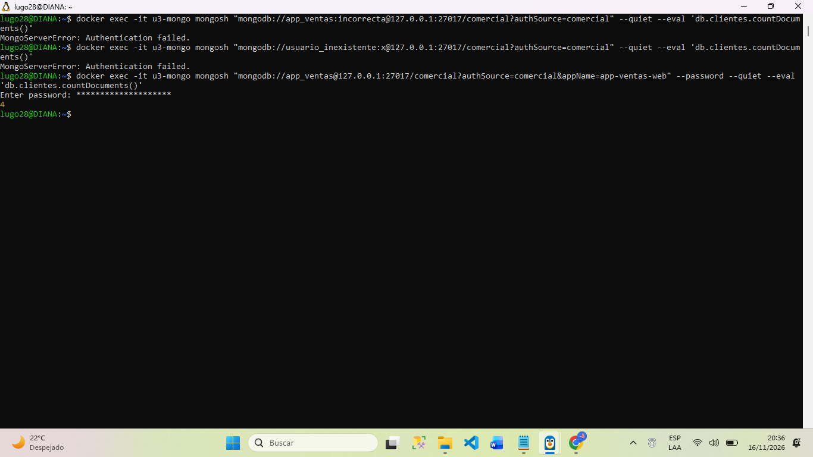

# Actividad 5. Accesos en la bitácora de mongod

**Estudiante:** Lugo Urías Diana Yasmin

**Unidad:** 3

**Laboratorio:** 02 — Trazabilidad en MongoDB

## ¿Qué hice en esta actividad?

En esta actividad trabajé con los registros de MongoDB para revisar cómo quedan guardados los intentos de acceso a la base de datos. El propósito fue identificar cuándo un usuario logra ingresar y qué información se registra cuando la autenticación falla.

Para realizar la prueba generé dos intentos de acceso incorrectos. En el primero utilicé el usuario `app_ventas`, pero escribí una contraseña equivocada. En el segundo intenté ingresar con un usuario llamado `usuario_inexistente`, que no está registrado en la base de datos.

En ambos casos MongoDB rechazó la conexión y mostró el mensaje:

`MongoServerError: Authentication failed.`

## Revisión de los intentos fallidos

Después de realizar las pruebas, regresé a la sesión de DBA y consulté la bitácora utilizando la función `bitacora()`.

Encontré dos intentos fallidos:

- El primero correspondía a `app_ventas`. El registro mostró el error `storedKey mismatch`, lo que indica que la contraseña proporcionada no coincidía con la almacenada.
- El segundo correspondía a `usuario_inexistente`. MongoDB indicó que no pudo encontrar ese usuario dentro de la base de datos `comercial`.

En el segundo intento aparecieron dos líneas con el mismo identificador de conexión, `conn2292`. Esto me permitió comprobar que no siempre cada línea representa un intento diferente. Por eso es importante revisar las conexiones y no contar directamente todas las entradas como intentos individuales.

## Comprobación de un acceso exitoso

Al principio, la búsqueda de accesos exitosos no mostró resultados. Para completar la comparación, realicé una nueva conexión utilizando correctamente la cuenta `app_ventas`.

La consulta se ejecutó sin problemas y devolvió un total de 4 documentos de la colección `clientes`.

Después volví a revisar la bitácora y encontré el acceso exitoso con los siguientes datos:

- Usuario: `app_ventas`.
- Aplicación: `app-ventas-web`.
- Conexión: `conn2409`.
- Código de resultado: `0`.
- Cliente: `127.0.0.1`.

Con esto pude comparar un acceso correcto con los dos intentos que habían sido rechazados.

## ¿Qué campo distingue un acceso fallido de uno exitoso?

El campo `msg` permite identificar el resultado de la autenticación. Cuando el acceso falla aparece `Failed to authenticate`, mientras que cuando se realiza correctamente aparece `Successfully authenticated`.

También es posible revisar el campo `result`, que mostró los códigos 18 y 11 para los errores de autenticación, y el código 0 para el acceso exitoso.

## ¿Qué diferencia hay entre una contraseña incorrecta y un usuario inexistente? ¿Por qué el cliente recibe el mismo mensaje?

La diferencia es que, en el primer caso, MongoDB reconoce al usuario, pero la contraseña proporcionada no es correcta. En el segundo, el usuario ni siquiera existe en la base de datos de autenticación.

Aunque las causas son diferentes, MongoDB muestra el mismo mensaje de error al cliente: `Authentication failed`. Esto es una medida de seguridad para evitar revelar si una cuenta está registrada o no.

## ¿Por qué el intento fallido aparece como mongosh 2.14.2 y no como app-ventas-web?

Esto ocurre porque los intentos fallidos se realizaron directamente desde la terminal con `mongosh`, por lo que MongoDB identificó esa herramienta como la aplicación que intentó conectarse.

En cambio, para el acceso exitoso utilicé una cadena de conexión que incluía `appName=app-ventas-web`. Por esa razón, la bitácora pudo identificarlo con ese nombre.

## Conclusión

Con esta actividad aprendí que la bitácora de MongoDB permite revisar información importante sobre los accesos a la base de datos, incluso cuando un usuario no consigue iniciar sesión.

También comprendí que no todos los errores de autenticación tienen la misma causa, aunque el mensaje que recibe el cliente sea igual. Además, pude observar que el nombre de la aplicación ayuda a identificar desde dónde se realizó una conexión.

Considero que estos registros son importantes porque permiten detectar intentos de acceso incorrectos, reconocer conexiones exitosas y tener más información cuando se necesita investigar alguna actividad sospechosa.

##Evidencia foto

