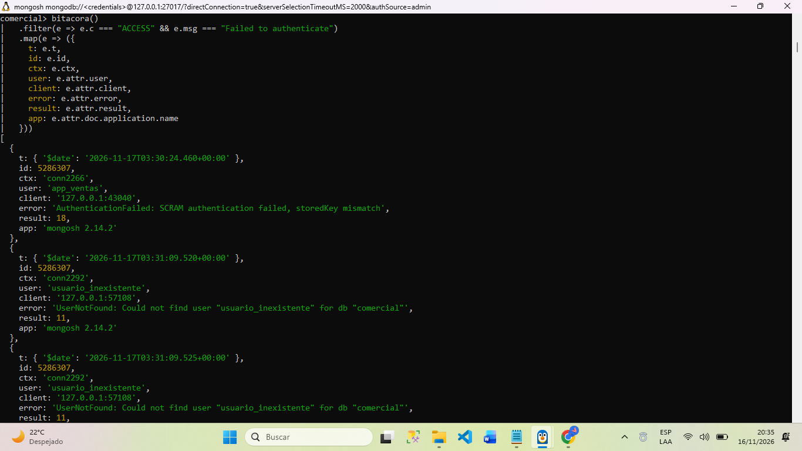

# Actividad 7. Cambios de privilegios: el límite más importante

**Estudiante:** Lugo Urías Diana Yasmin

**Unidad:** 3

**Laboratorio:** 02 — Trazabilidad en MongoDB

## ¿Qué hice en esta actividad?

En esta actividad revisé cómo cambian los permisos de los usuarios en MongoDB y qué tan fácil es identificar quién realizó esos cambios.

Primero guardé una copia del estado inicial de los usuarios y sus privilegios. Después activé el perfilador y agregué temporalmente el rol `dbAdmin` al usuario `app_ventas`, que anteriormente solamente tenía el rol `readWrite`.

Cuando busqué el cambio en los registros de MongoDB, las dos consultas devolvieron cero resultados. Esto me permitió comprobar que no siempre queda un registro directo de los cambios de permisos en las herramientas que estamos utilizando.

Para tener otra forma de comprobar lo sucedido, guardé una segunda instantánea y comparé ambas.

## ¿Qué resultados obtuve?

Al revisar las dos instantáneas encontré que al principio el usuario `app_ventas` solamente tenía el rol `readWrite` en la base de datos `comercial`.

Después de otorgarle el nuevo permiso, apareció también el rol `dbAdmin`.

Por otro lado, el usuario `soporte_ana` conservó su rol `read` durante toda la prueba.

Las dos capturas fueron realizadas por el usuario `admin`.

## ¿Cambió el privilegio de app_ventas? ¿Qué rol se agregó?

Sí, el permiso de `app_ventas` cambió. Se le agregó el rol `dbAdmin`, pero conservó el rol `readWrite` que ya tenía.

Esto se pudo comprobar al comparar la información guardada en las dos instantáneas.

## ¿Quién agregó el rol y cuándo ocurrió exactamente?

No fue posible comprobarlo directamente mediante los registros consultados, porque tanto el perfilador como la bitácora general devolvieron cero resultados relacionados con el cambio.

Lo que sí pude identificar es que ocurrió entre las 03:51:52 y las 03:55:44 UTC del 17 de noviembre de 2026.

Aunque realicé el cambio desde mi sesión DBA, las instantáneas solamente muestran quién las tomó, no quién otorgó el permiso.

## ¿Por qué un cambio de privilegios es uno de los eventos auditables más importantes?

Porque los permisos determinan lo que cada usuario puede hacer dentro de una base de datos. Si alguien recibe permisos que no necesita, podría acceder a información o realizar cambios que normalmente no tendría permitidos.

Por eso considero importante revisar los privilegios y estar pendientes de cualquier modificación.

## ¿Con qué frecuencia tomaría instantáneas?

Yo tomaría una instantánea diariamente y también cada vez que se realice un cambio importante en los usuarios o sus permisos.

La frecuencia dependería de qué tan importante sea la información, cuántos usuarios existan y qué tan seguido se modifiquen sus privilegios.

## ¿Quién debería poder escribir en auditoria.instantaneas_privilegios?

Considero que solamente el DBA o una cuenta de servicio autorizada debería poder guardar información en esa colección.

Los usuarios de las aplicaciones no deberían tener permisos para modificar o eliminar las instantáneas, ya que podrían alterar la evidencia que necesitamos conservar.

## ¿Cómo comunicaría esta limitación a Dirección?

MongoDB Community no permite identificar directamente quién realizó cada cambio de privilegios mediante los registros que revisamos.

Como alternativa, podemos guardar instantáneas para comparar los permisos y detectar cuándo hubo modificaciones.

Recomendamos automatizar este proceso y proteger los registros para tener un mejor control de la seguridad.

## Restauración de los permisos y la configuración

Al terminar la prueba quité el rol `dbAdmin` que había agregado temporalmente a `app_ventas`, dejando nuevamente su permiso original `readWrite`.

También restablecí el perfilador al nivel 1 con el filtro de operaciones `insert`, `update` y `remove`, como lo tenía configurado en la actividad 4.

## Conclusión

Con esta actividad aprendí que no basta con saber qué permisos tiene cada usuario, también es importante llevar un control de los cambios que se realizan.

Aunque MongoDB no me permitió identificar directamente quién agregó el nuevo rol, las dos instantáneas me ayudaron a comprobar que sí hubo una modificación.

Me quedó claro que guardar este tipo de información es una buena forma de mantener un mayor control sobre los usuarios y detectar cambios que podrían poner en riesgo la base de datos.

##Evidencia foto

